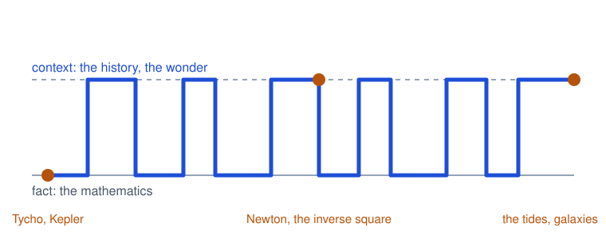
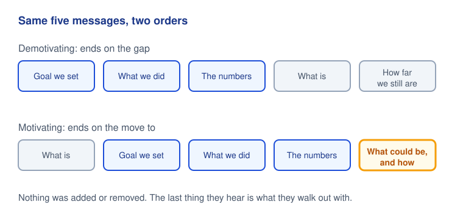
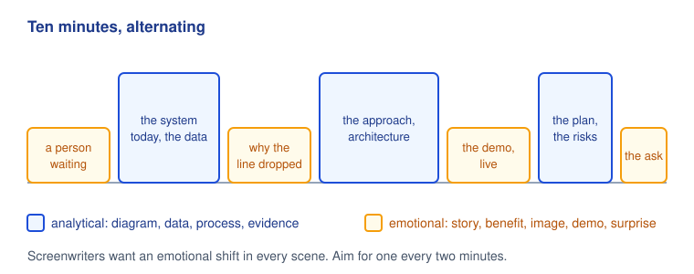
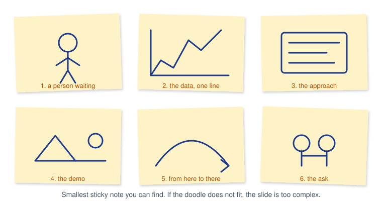
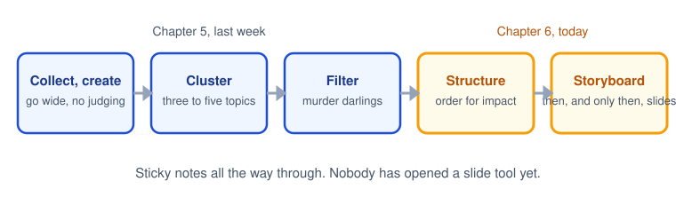

# CPSC 403: Computer Science Seminar

## Week 6, October 20, 2026

Resonate, the rest of Chapter 6, then Chapter 7: Deliver Something They'll Always Remember.

Trinity College · Fall 2026

---
layout: two-cols
---

# Check in

Scan the code, pick your name, pick today's section, and type the code word. Lowercase, but I am not picky about case.

Code word: <strong>bishop</strong>

Same form every week, different word. Timestamps count as attendance.

::right::

---
layout: center
---

# Today

<v-clicks>

- Housekeeping: post-mortems, October 27, Round 2
- Finish Chapter 6: Feynman, done properly this time, then order and storyboard
- Chapter 7: the one moment they will still be talking about
- Today's talks, with feedback after each

</v-clicks>

---

# Housekeeping

<v-clicks>

- **Post-mortem 1** is due one week after your own talk. Four are in and get read this week. Specific moments, not timestamps.
- **October 27** is the last Round 1 day: four talks in Section 01, three in Section 02. Two people are still not on the sheet.
- **Round 2, the project pitch,** runs November 3 to 24. The sheet is open now; two of you are already on it. Sign up as a team.
- **AI Center:** Friday, October 23, 3 PM on Zoom. Clients start visiting about now.
- **December 16,** morning: the student conference. Ten minutes each, faculty and the Travelers representative in the room.

</v-clicks>

---
layout: center
class: text-center
---

# Chapter 6, continued

## Structure Reveals Insights

We stopped at Feynman two weeks ago. Picking up there.

---
layout: image-right
image: ./images/feynman-los-alamos.jpg
class: text-sm
---

# Case study: Richard Feynman

<v-clicks>

- Caltech students who were not physics majors dropped into his lectures for fun. They called him the Great Explainer.
- His theory, from a BBC interview: be deliberately chaotic and catch each listener on a different hook. The history person is bored by the math, the math person by the history, so nobody is bored all the time.
- **Analytical devices:** signal the structure up front, itemize ("three things"), visualize with gestures more than symbols.
- **Emotional devices:** wonder, and self-deprecating humor at even intervals.

</v-clicks>

---

# Feynman's sparkline

<strong>The gravity lecture.</strong> A whole talk of <em>what is</em>. Zoom in and it still alternates: Tycho's data, then the law; Kepler's ellipses, then the inverse square; the equation, then the tides. Fact, context, fact, context.

<strong>"There's Plenty of Room at the Bottom."</strong> The laws of physics as they are, then the same laws at the scale of atoms, where machines could be built. What is, what could be, at a tighter frequency than most non-technical talks.

A technical talk is not excused from contrast. It just alternates on a shorter cycle.

---

# Order the messages for impact

Duarte's example is a quarterly update. Same slides. One order sends employees out deflated; the other sends them out ready to help. The association between pieces changes what each piece means.

---

# Two kinds of content

<strong>Analytical.</strong> Diagram, feature, data, evidence, example, system, process, facts, supporting documentation.

Every hard drive on campus is full of these slides.

<strong>Emotional.</strong> Stories, benefits, analogies, a prop, a reveal, an evocative image, a shocking number, an invitation to marvel, humor, a surprise.

A tiny fraction of decks have even one.

<v-clicks>

- Anything on the left can be told from the right. A circle inside a bigger circle is neutral until it is the story of the acquisition and what it took to get there.
- Data is analytical until you say why the line went up or down. Then it is a story.
- Peter Guber's point: the room's physical response, the laugh, the gasp, the wince, is part of the story. You orchestrate it.

</v-clicks>

---

# Alternate, like a screenwriter

Screenwriters check that every scene shifts the emotion, and that the shifts alternate between pain and pleasure. Go through your outline and mark each message A or E. Three A's in a row is where the room checks its phone.

---

# Contrast the delivery too

| **Traditional** | **Less traditional** |
|---|---|
| Hide behind the podium | Move |
| Read the slides | Minimize the slides |
| Talk about the product | Show the product |
| Flawless knowledge | A little self-deprecation |
| Monotone | Vary the voice and the pace |
| One-way delivery | A poll, a show of hands, a question |

<v-clicks>

- Audiences raised on screens squirm after ten minutes of one thing. Something new has to keep happening.
- Every slide you drop is a moment of human connection you get back. They came to see a person, not a deck.
- Mode changes need planning. In a ten-minute talk, one is plenty: a live demo, a question to the room, a prop.
- Ralston showed the game running. Sean brought the espresso vocabulary and not the machine. Both choices were choices.

</v-clicks>

---
layout: image-right
image: ./images/hitchcock.jpg
---

# Storyboard it, like Hitchcock

<v-clicks>

- Hitchcock drew his films before he shot them: sets, costumes, every camera angle, down to how many birds were in the frame and how far away the camera stood.
- Drawn, not just written. The planning saved time and money on the set, and the film in his head was the film on the screen.
- A storyboard does the same for a talk: tape it to the wall, look at the sequence, the transitions, the framing, and see whether it hangs together before you build anything.
- Walt Disney put it plainly: at his studio they drew their stories rather than wrote them.

</v-clicks>

---

# Storyboard on the smallest sticky note

<v-clicks>

- Dan Roam's point in *Back of the Napkin*: real problems are multidimensional, and you cannot fully understand one until you draw it.
- Doodles, not art. One sticky per slide, the smallest size you can find, so you cannot overfill it.
- If the sketch is too complex, time-consuming, or costly, cut it now and find another way to carry that message.
- Say the talk out loud and draw what you hear yourself say. If you can draw it, they can see it.

</v-clicks>

---

# The process so far

Notice what is missing. Nobody has opened Slidev, Keynote, or PowerPoint. The deck is the last thing you make, and by then you already know what every slide is for.

---
layout: image-right
image: ./images/watch-disassembled.jpg
---

# Rule 6: Structure is greater than the sum of its parts

<v-clicks>

- Duarte's wording, roughly: a leaf, a building, and ice cream all have structure, and structure drives the shape and expression of each. Same for a talk.
- The assembled watch in that photo is the same parts as the ones laid out around it. The difference is the arrangement.
- Change the structure, large or small, and you change how the content is received. Pull the talk out of the slide tool, check the shape, and only then arrange for impact.

</v-clicks>

---
layout: center
class: text-center
---

# Chapter 7

## Deliver Something They'll Always Remember

Structure gets them through the talk. This chapter is about what they carry out of the room.

---

# Something They'll Always Remember

<strong>The idea.</strong> Plan one moment, on purpose, that drives the big idea home so hard the audience describes it to someone who was not there. Duarte's acronym: S.T.A.R.

<strong>Why it matters for you.</strong> Faculty and the Travelers representative see a dozen pitches on December 16. Prizes come in April. Success is being the one they remember weeks later.

It should magnify the big idea, not distract from it. Sincere and significant, not a summer-camp skit.

---

# Five ways to make one

<strong>Dramatization</strong>
A prop, a demo, a reenactment. Small is fine.

<strong>Sound bite</strong>
A phrase short enough to repeat, built to be quoted.

<strong>Visual</strong>
One image that carries an emotion the words cannot.

<strong>Story</strong>
Information packaged so it can be retold.

<strong>Statistic</strong>
A number that shocks, given room to land.

<v-clicks>

- Pick one. A ten-minute talk has room for one planned moment, and the rest of the talk exists to set it up and pay it off.
- Know the room. What resonates with a hackathon crowd lands differently with a hospital's clinical staff, or with a faculty panel.
- Visual beats auditory. Most of the famous ones are something the audience *saw*.

</v-clicks>

---
layout: two-cols
---

# Feynman and the O-ring

<v-clicks>

- February 1986, a televised hearing of the Rogers Commission on the Challenger accident.
- Feynman asks for a glass of ice water. In his pocket: a piece of the booster-seal rubber, squeezed flat in a small clamp.
- In, wait, out, release. It stays flat. At freezing, the material has no spring in it for several seconds.
- Everyone knew it should have snapped back instantly. No slide, no equation. The reporters led with it.
- The finding was also in the written report. The glass of water is what people remember forty years later.

</v-clicks>

::right::

---
layout: image-right
image: ./images/gates-ted-mosquitoes.jpg
---

# Gates and the mosquitoes

<v-clicks>

- TED, 2009. Bill Gates is talking about malaria: millions dead, hundreds of millions infected at any moment.
- He sets up the contrast first: more money goes into baldness drugs for rich men than into malaria for the poor.
- Then he opens a jar of mosquitoes on stage. "There's no reason only poor people should have the experience."
- Analytical content, then a dramatization that makes the number personal. The photo you see is the room reacting.

</v-clicks>

---
layout: image-right
image: ./images/jobs-macbook-air.jpg
---

# Jobs and the envelope

<v-clicks>

- Macworld, January 2008. "So thin it even fits inside one of those envelopes you see floating around the office."
- He walks to the side of the stage, picks up an interoffice envelope, and pulls out the MacBook Air.
- The spec sheet said 0.76 inches. The envelope said *thin* in a way a number cannot.
- Pattern to steal: say the claim, then let a physical object prove it. Claim, reveal, pause.

</v-clicks>

---
layout: image-right
image: ./images/michael-pollan.jpg
---

# Pollan and the cheeseburger

<v-clicks>

- Michael Pollan walks on stage at Pop!Tech carrying a fast-food bag. "A little something for later." Puts it down. Starts the talk.
- Suspense for free: the whole room wonders about the bag.
- When he reaches crude oil and the food supply, out comes a cheeseburger, then a container of oil and a glass. He fills it. "But that's not all." A second glass. A third. Part of a fourth. Twenty-six ounces of oil for one double cheeseburger.
- The number was in his slides. The glasses on the table are what people told their friends.

</v-clicks>

---
layout: image-right
image: ./images/neil-armstrong.jpg
---

# Repeatable sound bites

<v-clicks>

- Armstrong had six hours and forty minutes between landing and stepping onto the Moon. He used part of it to write one sentence.
- Phrases that become headlines are planned, not improvised.
- Three ways to make a phrase stick: say it more than once; pause after it so people can write it down; put the words on a slide so they get it by eye and ear.
- Jobs said "reinvent the phone" five times at the iPhone launch. It was in Apple's press release. The next day it was *PC World*'s headline.
- Your version: the one sentence your advisor should be able to repeat about your project without looking at anything.

</v-clicks>

---

# Four devices that make a phrase quotable

| Device | Example |
|---|---|
| **Imitate a famous phrase** | Never give a talk you wouldn't want to sit through yourself. |
| **Repeat at the start of a series** | "It was the best of times, it was the worst of times…" |
| **Repeat in the middle** | "…perplexed, but not in despair; persecuted, but not forsaken…" |
| **Repeat at the end** | "…of the people, by the people, for the people…" |

<v-clicks>

- Dickens, Paul to the Corinthians, Lincoln. The devices are old because they work on ears, and ears have not changed.
- For a project pitch, imitation is the easiest: borrow a shape everyone already knows and swap in your project.
- Test it by saying it out loud to a roommate. If they can say it back ten minutes later, keep it.

</v-clicks>

---
layout: image-right
image: ./images/iraq-inked-fingers.jpg
---

# Evocative visuals

<v-clicks>

- When people recall an image, they recall the feeling that came with it. A photograph can do what a paragraph cannot.
- Duarte's pair: Iraq, 2005, voters raising ink-stained fingers in defiance of bombs. Zimbabwe, 2008, the same ink demanded as proof you voted for the only candidate. Same gesture, opposite emotion.
- One full-screen image to make a point. Two side by side to make a contrast: the ocean, then the beach full of trash.
- For you: a single frame from a traffic camera next to the same frame with the detections drawn on it says more than a precision number.

</v-clicks>

---
layout: two-cols
---

# Emotive storytelling

<v-clicks>

- Pastor John Ortberg builds each twenty-minute sermon like cloth on a loom.
- The **warp**, the vertical threads: one master theme and the evidence for it.
- The **woof**, shuttling back and forth: personal stories. In the sermon Duarte analyzed, one master story, his sister's rag doll, kept coming back as glue.
- The sparkline shows what the stories do: each return to the doll re-opens the gap between what is and what could be, and the room laughs at regular intervals.
- Your project has a person in it: a patient aging out of pediatric care, someone buying a ticket, a reader walking an 1888 street. Tell their story once, then bring them back.

</v-clicks>

::right::

---

# Shocking statistics

1,350

cameras, one city

That is the number. It is not yet a moment.

<v-clicks>

- If a number is shocking, do not gloss over it. Slow down, give it the screen, give it a narrator.
- The Long Island Index published seven years of reports full of accurate numbers. Nothing moved. In 2010 they told the same numbers as a four-minute visual story, *The Clock Is Ticking*, and officials started acting.
- Jobs: "five million songs a day" became "58 songs every second of every minute of every hour." Same fact, now it has scale.
- Your move: pick the one number in your project that surprised *you*, and build the thirty seconds around it.

</v-clicks>

---

# Jobs, 2007: all five in one talk

<strong>Sound bite</strong> "reinvent the phone," five times. <strong>Statistic</strong> 58 songs a second. <strong>Visual</strong> an iPod with a rotary dial, as the joke before the reveal.

<strong>Dramatization</strong> the product itself: the room gasped the first time he flicked the screen to scroll. <strong>Story</strong> "You had me at scrolling."

---

# Your S.T.A.R. moment in a ten-minute talk

<v-clicks>

- **Dramatization:** run the thing. A live demo of the real system, with a recorded fallback you have already tested on the room's projector.
- **Prop:** the headset, a printed frame from the camera feed, the paper form your chatbot replaces.
- **Sound bite:** the sentence your advisor repeats for you on December 16.
- **Visual:** before and after, side by side, nothing else on the slide.
- **Story:** one named person your project is for. Bring them back at the end.
- **Statistic:** the number that surprised you, with a narrator.

</v-clicks>

<v-clicks>

<strong>One.</strong> Ten minutes holds one planned moment. Everything before it sets it up; everything after pays it off.

<strong>Rehearse it.</strong> The memorable moments in this chapter look spontaneous. None of them were. Feynman bought the clamp the night before.

<strong>Not kitschy.</strong> The audience on December 16 is faculty and a company representative. Sincere beats clever.

</v-clicks>

---

# Rule 7: Memorable moments are repeated and retransmitted, so they cover longer distances

A talk reaches the people in the room. A moment reaches the people they tell. That is the whole physics of this chapter: the thing that gets repeated is the thing that travels.

---
layout: center
---

# Today's presenters

Section 01, 1:30

1. Taha Moula

2. Shane Ivey and Sarah Marvin

3. Shamsher Ghising Tamang

Section 02, 2:55

1. Amraa Anar

While you listen: was there a **moment**? Which of the five was it? Where did the talk **alternate** between facts and feeling, and did it **end on the move to**? Say what landed, then one thing to change.

---

# Round 1: where the sheet stands

**Section 01**

| Date | Presenters |
|---|---|
| Sept 22 | Liu ✓, Ethan ✓ |
| Sept 29 | Biruk and Gabe ✓ |
| Oct 6 | Sean ✓, Ralston ✓ |
| Oct 20 | Taha, Shane and Sarah, Shamsher |
| Oct 27 | Zoe and Kayla, AJ, Patrick, *open* |

**Section 02**

| Date | Presenters |
|---|---|
| Sept 29 | Gabby and Noella ✓ |
| Oct 20 | Amraa, *open*, *open* |
| Oct 27 | Allan and Varya, Sloane, Jeev |

Two people are not on the sheet yet, and October 27 is the last Round 1 day. Anyone may present in the other section.

---
layout: center
---

# For October 27

- Presenters today: **post-mortem 1** due in one week on Moodle. What you intended, what happened, what you would change.
- October 27 presenters: slides to Moodle before class. Seven talks that day across both sections, so ten minutes means ten.
- Read Chapter 8, *There's Always Room to Improve*. It is the post-mortem chapter, and we will use it that way.
- **Round 2 sign-up** is open: one slot per team, November 3 to 24.
- **For your pitch:** pick your one S.T.A.R. moment and write the one sentence you want repeated. Bring both to your advisor.

---
layout: center
class: text-sm
---

**Image credits.** Richard Feynman, Los Alamos ID badge, United States Army, public domain. Alfred Hitchcock, Fred Palumbo for the New York World-Telegram and Sun, public domain. Prim wristwatch disassembled, Kozuch, CC BY-SA 3.0. Bill Gates at TED 2009, Steve Jurvetson, CC BY 2.0. Steve Jobs demos the MacBook Air, Macworld 2008, Tom Coates, CC BY 2.0. Michael Pollan, 2022, Christopher Michel, CC BY-SA 4.0. Neil Armstrong, NASA, public domain. Iraqi voters' inked fingers, 2005, public domain. Diagrams drawn for this course.
