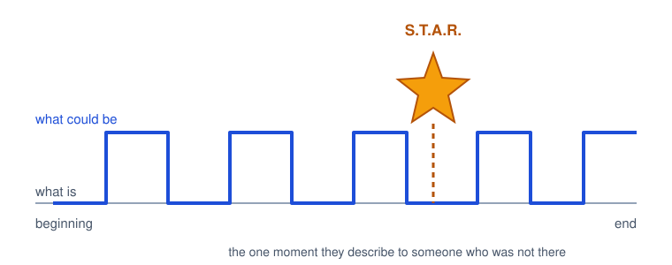
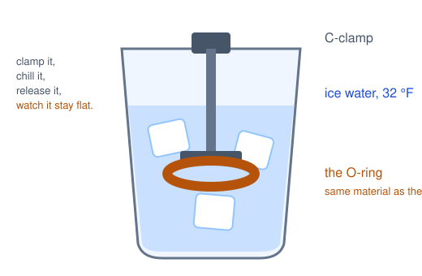
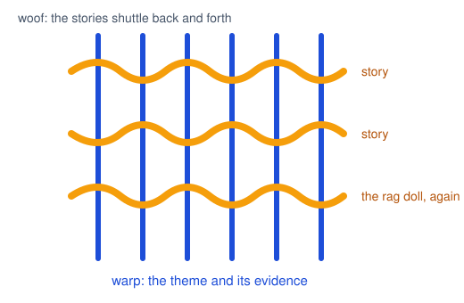
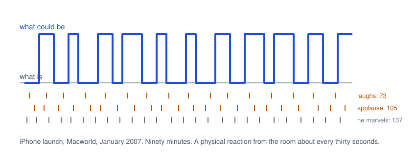
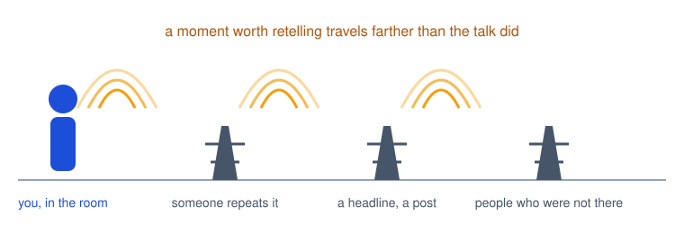
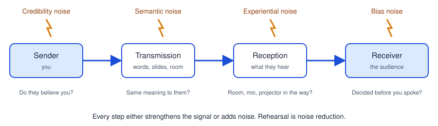
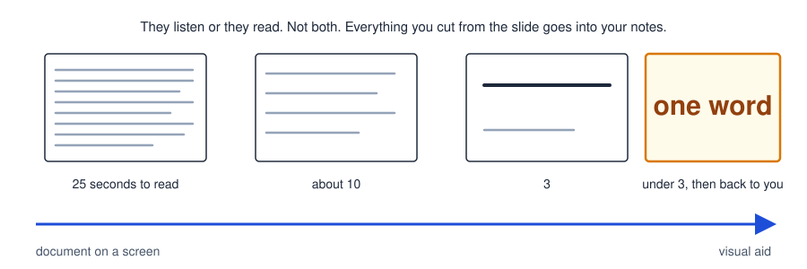
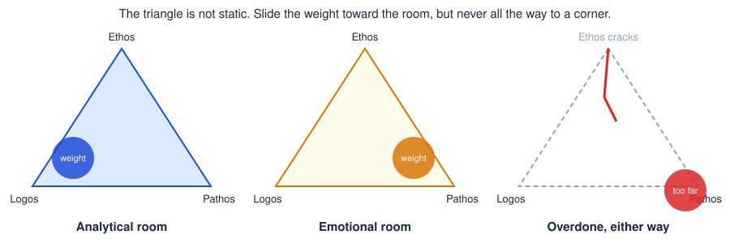
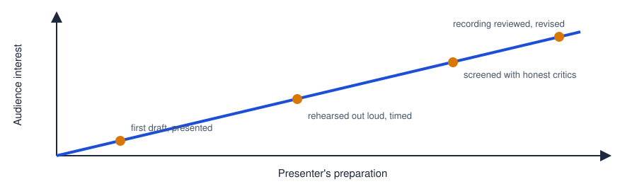

# CPSC 403: Computer Science Seminar

## Week 7, October 27, 2026

Resonate, the rest of Chapter 7, then Chapter 8: There's Always Room to Improve. Last day of Round 1.

Trinity College · Fall 2026

---
layout: two-cols
---

# Check in

Scan the code, pick your name, pick today's section, and type the code word. Lowercase, but I am not picky about case.

Code word: <strong>agentsmith</strong>

Same form every week, different word. Timestamps count as attendance.

::right::

---
layout: center
---

# Today

<v-clicks>

- Housekeeping: post-mortems, November 3, Round 2
- Six talks, four in Section 01 and two in Section 02, with feedback after each
- Finish Chapter 7: Section 01 from the S.T.A.R. moment, Section 02 from the four quotable devices
- Chapter 8, as far as we get: the post-mortem chapter, used as one

</v-clicks>

---

# Housekeeping

<v-clicks>

- **Round 1 ends today.** If you presented October 20, your post-mortem is due today. Everyone else: one week after your talk. Specific moments, not timestamps.
- **November 3:** Round 2 begins in Section 01 with Ralston. Section 02 hears three Round 1 makeup talks: Kuany, Abdel, Jeev.
- **Round 2 sign-up** runs November 3 to 24, one slot per team. Five teams are on the sheet. Slides to Moodle before class, as before.
- **AI Center:** Friday, October 30, 3 PM on Zoom. Clients are visiting now.
- **December 16,** MECC 270, 8:30 AM: the student conference. Ten-minute slots, back to back, faculty and the Travelers representative in the room.

</v-clicks>

---
layout: center
class: text-center
---

# Chapter 7

## Deliver Something They'll Always Remember

Structure gets them through the talk. This chapter is about what they carry out of the room.

---

# Something They'll Always Remember

<strong>The idea.</strong> Plan one moment, on purpose, that drives the big idea home so hard the audience describes it to someone who was not there. Duarte's acronym: S.T.A.R.

<strong>Why it matters for you.</strong> Faculty and the Travelers representative see a dozen pitches on December 16. Prizes come in April. Success is being the one they remember weeks later.

It should magnify the big idea, not distract from it. Sincere and significant, not a summer-camp skit.

---

# Five ways to make one

<strong>Dramatization</strong>
A prop, a demo, a reenactment. Small is fine.

<strong>Sound bite</strong>
A phrase short enough to repeat, built to be quoted.

<strong>Visual</strong>
One image that carries an emotion the words cannot.

<strong>Story</strong>
Information packaged so it can be retold.

<strong>Statistic</strong>
A number that shocks, given room to land.

<v-clicks>

- Pick one. A ten-minute talk has room for one planned moment, and the rest of the talk exists to set it up and pay it off.
- Know the room. What resonates with a hackathon crowd lands differently with a hospital's clinical staff, or with a faculty panel.
- Visual beats auditory. Most of the famous ones are something the audience *saw*.

</v-clicks>

---
layout: two-cols
---

# Feynman and the O-ring

<v-clicks>

- February 1986, a televised hearing of the Rogers Commission on the Challenger accident.
- Feynman asks for a glass of ice water. In his pocket: a piece of the booster-seal rubber, squeezed flat in a small clamp.
- In, wait, out, release. It stays flat. At freezing, the material has no spring in it for several seconds.
- Everyone knew it should have snapped back instantly. No slide, no equation. The reporters led with it.
- The finding was also in the written report. The glass of water is what people remember forty years later.

</v-clicks>

::right::

---
layout: image-right
image: ./images/gates-ted-mosquitoes.jpg
---

# Gates and the mosquitoes

<v-clicks>

- TED, 2009. Bill Gates is talking about malaria: millions dead, hundreds of millions infected at any moment.
- He sets up the contrast first: more money goes into baldness drugs for rich men than into malaria for the poor.
- Then he opens a jar of mosquitoes on stage. "There's no reason only poor people should have the experience."
- Analytical content, then a dramatization that makes the number personal. The photo you see is the room reacting.

</v-clicks>

---
layout: image-right
image: ./images/jobs-macbook-air.jpg
---

# Jobs and the envelope

<v-clicks>

- Macworld, January 2008. "So thin it even fits inside one of those envelopes you see floating around the office."
- He walks to the side of the stage, picks up an interoffice envelope, and pulls out the MacBook Air.
- The spec sheet said 0.76 inches. The envelope said *thin* in a way a number cannot.
- Pattern to steal: say the claim, then let a physical object prove it. Claim, reveal, pause.

</v-clicks>

---
layout: image-right
image: ./images/michael-pollan.jpg
---

# Pollan and the cheeseburger

<v-clicks>

- Michael Pollan walks on stage at Pop!Tech carrying a fast-food bag. "A little something for later." Puts it down. Starts the talk.
- Suspense for free: the whole room wonders about the bag.
- When he reaches crude oil and the food supply, out comes a cheeseburger, then a container of oil and a glass. He fills it. "But that's not all." A second glass. A third. Part of a fourth. Twenty-six ounces of oil for one double cheeseburger.
- The number was in his slides. The glasses on the table are what people told their friends.

</v-clicks>

---
layout: image-right
image: ./images/neil-armstrong.jpg
---

# Repeatable sound bites

<v-clicks>

- Armstrong had six hours and forty minutes between landing and stepping onto the Moon. He used part of it to write one sentence.
- Phrases that become headlines are planned, not improvised.
- Three ways to make a phrase stick: say it more than once; pause after it so people can write it down; put the words on a slide so they get it by eye and ear.
- Jobs said "reinvent the phone" five times at the iPhone launch. It was in Apple's press release. The next day it was *PC World*'s headline.
- Your version: the one sentence your advisor should be able to repeat about your project without looking at anything.

</v-clicks>

---

# Four devices that make a phrase quotable

| Device | Example |
|---|---|
| **Imitate a famous phrase** | Never give a talk you wouldn't want to sit through yourself. |
| **Repeat at the start of a series** | "It was the best of times, it was the worst of times…" |
| **Repeat in the middle** | "…perplexed, but not in despair; persecuted, but not forsaken…" |
| **Repeat at the end** | "…of the people, by the people, for the people…" |

<v-clicks>

- Dickens, Paul to the Corinthians, Lincoln. The devices are old because they work on ears, and ears have not changed.
- For a project pitch, imitation is the easiest: borrow a shape everyone already knows and swap in your project.
- Test it by saying it out loud to a roommate. If they can say it back ten minutes later, keep it.

</v-clicks>

---
layout: image-right
image: ./images/iraq-inked-fingers.jpg
---

# Evocative visuals

<v-clicks>

- When people recall an image, they recall the feeling that came with it. A photograph can do what a paragraph cannot.
- Duarte's pair: Iraq, 2005, voters raising ink-stained fingers in defiance of bombs. Zimbabwe, 2008, the same ink demanded as proof you voted for the only candidate. Same gesture, opposite emotion.
- One full-screen image to make a point. Two side by side to make a contrast: the ocean, then the beach full of trash.
- For you: a single frame from a traffic camera next to the same frame with the detections drawn on it says more than a precision number.

</v-clicks>

---
layout: two-cols
---

# Emotive storytelling

<v-clicks>

- Pastor John Ortberg builds each twenty-minute sermon like cloth on a loom.
- The **warp**, the vertical threads: one master theme and the evidence for it.
- The **woof**, shuttling back and forth: personal stories. In the sermon Duarte analyzed, one master story, his sister's rag doll, kept coming back as glue.
- The sparkline shows what the stories do: each return to the doll re-opens the gap between what is and what could be, and the room laughs at regular intervals.
- Your project has a person in it: a patient aging out of pediatric care, someone buying a ticket, a reader walking an 1888 street. Tell their story once, then bring them back.

</v-clicks>

::right::

---

# Shocking statistics

1,350

cameras, one city

That is the number. It is not yet a moment.

<v-clicks>

- If a number is shocking, do not gloss over it. Slow down, give it the screen, give it a narrator.
- The Long Island Index published seven years of reports full of accurate numbers. Nothing moved. In 2010 they told the same numbers as a four-minute visual story, *The Clock Is Ticking*, and officials started acting.
- Jobs: "five million songs a day" became "58 songs every second of every minute of every hour." Same fact, now it has scale.
- Your move: pick the one number in your project that surprised *you*, and build the thirty seconds around it.

</v-clicks>

---

# Jobs, 2007: all five in one talk

<strong>Sound bite</strong> "reinvent the phone," five times. <strong>Statistic</strong> 58 songs a second. <strong>Visual</strong> an iPod with a rotary dial, as the joke before the reveal.

<strong>Dramatization</strong> the product itself: the room gasped the first time he flicked the screen to scroll. <strong>Story</strong> "You had me at scrolling."

---

# Your S.T.A.R. moment in a ten-minute talk

<v-clicks>

- **Dramatization:** run the thing. A live demo of the real system, with a recorded fallback you have already tested on the room's projector.
- **Prop:** the headset, a printed frame from the camera feed, the paper form your chatbot replaces.
- **Sound bite:** the sentence your advisor repeats for you on December 16.
- **Visual:** before and after, side by side, nothing else on the slide.
- **Story:** one named person your project is for. Bring them back at the end.
- **Statistic:** the number that surprised you, with a narrator.

</v-clicks>

<v-clicks>

<strong>One.</strong> Ten minutes holds one planned moment. Everything before it sets it up; everything after pays it off.

<strong>Rehearse it.</strong> The memorable moments in this chapter look spontaneous. None of them were. Feynman bought the clamp the night before.

<strong>Not kitschy.</strong> The audience on December 16 is faculty and a company representative. Sincere beats clever.

</v-clicks>

---

# Rule 7: Memorable moments are repeated and retransmitted, so they cover longer distances

A talk reaches the people in the room. A moment reaches the people they tell. That is the whole physics of this chapter: the thing that gets repeated is the thing that travels.

---
layout: center
class: text-center
---

# Chapter 8

## There's Always Room to Improve

The post-mortem chapter. Everything in it is a question you can ask about the talk you just gave.

---

# Amplify the signal, minimize the noise

<strong>Duarte's first job</strong> was selling custom high-frequency cable. Every stage of making one existed to protect the signal, and a cable outside tolerance did not ship. She treats a talk the same way.

<strong>Last week in this room:</strong> an HDMI cable came out and the microphone went with it. The people on Zoom heard nothing for ten minutes. Experiential noise, and nobody's fault, and still the talk did not arrive.

---

# The first impression starts before you speak

<v-clicks>

- The room categorizes you in seconds and then decides whether you are someone they can connect with. Aristotle wanted the speech alone to earn trust. Modern audiences are shallower than Aristotle.
- What they are actually thinking about while they wait: the coffee, the line for the restroom, whether the last speaker was any good. The bar is low. Clear it on purpose.
- Everything counts: how you walk up, how long the laptop takes, what is on the screen while you plug in, the email you sent the day before.
- Not a joke, not a gimmick. Show who you are and why you care. They are about to be asked to walk in your shoes.

</v-clicks>

<v-clicks>

<strong>Duarte's own story.</strong> She used to arrive at her workshops trying to finish a day's work first: testing the projector, checking files, wound tight. The early arrivals got "I am too busy for you" before she said a word, and the room stayed cold.

<strong>Garr Reynolds,</strong> same kind of workshop, walked in early, shook hands, asked people questions. Same material. His room was his before the first slide.

<strong>For you:</strong> the thirty seconds between "next up" and your first sentence are part of the talk. Have the file open. Look at the room, not the cable.

</v-clicks>

---
layout: image-right
image: ./images/babel-bruegel.jpg
---

# Hop down from your tower

<v-clicks>

- Every specialty grows its own vocabulary, and the vocabulary grows weekly. The experts forget it is a dialect.
- Duarte's picture is Babel: one language until pride scattered it. Jargon scatters a room the same way. The people who could fund or help you stop understanding and quietly stop listening.
- Your idea's value is judged by how well you can communicate it, not by the idea. That is unfair and true.
- Know which words are yours and which are everyone's, and switch deliberately. If a term must stay, translate it in the same breath.
- The December 16 room: faculty from several departments and a company representative. "MCP server," "RAG," "YOLO," "fine-tune" all need a plain-English twin.

</v-clicks>

---
layout: image-right
image: ./images/mcclintock-1947.jpg
---

# Case in point: Barbara McClintock

<v-clicks>

- In the 1940s she worked out that genes switch physical traits on and off. Nobel Prize, eventually: 1983.
- The work was met with skepticism and not fully understood until the 1970s. Part of the reason was how she talked about it.
- Vivid inner picture, rapid delivery, and sentences that jumped from the microscope to the model to the conclusion to the result without stopping. Audiences could not keep up, and most did not try.
- Thirty years of delay for a correct idea. The signal was fine. The transmission was not.

</v-clicks>

---
layout: image-right
image: ./images/lincoln-gettysburg.jpg
class: text-sm
---

# Value brevity

<v-clicks>

- Talks fail from too much, not too little. Share what this audience needs now, not everything you know.
- Gettysburg, 1863. Edward Everett, the featured speaker, went two hours. Lincoln went about two minutes: 278 words. The photographers were still setting up when he finished.
- Everett wrote the next day that he wished he had come as near the central idea in two hours as Lincoln had in two.
- Short, and still the whole form: what is (the founding, the war, why we are here), the shock (we cannot consecrate this ground), the call (resolve), the new bliss.
- Wilson, roughly: a ten-minute speech takes a week to prepare; an hour he could give now. Set a limit inside the limit: ten on the sheet, eight in rehearsal.

</v-clicks>

---

# Wean yourself from the slides

<v-clicks>

- You deliver the message. The slides are the set, not the script.
- People take in one message at a time. They will read the slide or listen to you. They cannot do both.
- A default text slide takes about twenty-five seconds to read. Forty of them is sixteen minutes of your talk spent reading, not listening.
- There is no right number of slides. Hollywood keeps scenes under three minutes for fear of losing the room; you do not have their budget, so change the picture at least every two.
- Structure first, with the time limit in mind, and you will never say "where did the time go, I have forty-three slides left."

</v-clicks>

<v-clicks>

<strong>Duarte's 128 slides.</strong> Forty-five-minute keynote, deck sent a month early. A week out, the organizers cut her to twenty minutes; she trimmed and re-timed. On the day the emcee asked her to fill the full forty-five, "because people like Q and A." They had invented the cut because 128 slides looked like a talk that would run long.

<strong>Lesson for the counters:</strong> one idea per slide means more slides, not a longer talk. The number of slides says nothing about the length. The structure does.

</v-clicks>

---

# Reduce what is on the slide

<strong>Keep only what helps them remember.</strong> Phrases become words. Anything they would need to read goes into the notes, and the notes go into presenter view on the screen facing you.

<strong>Document or presentation?</strong> If someone asks for five slides to read later, that is a document: pack it. If you are standing in front of it, that is a presentation: strip it. Different artifacts, different rules.

Duarte's test: can the room take in the slide in under three seconds and come back to you? If not, it is competing with you.

---

# Balance the emotion

<v-clicks>

- Chapters 5 through 7 pushed emotion because most talks have none. Chapter 8 asks for the right amount, which depends on the room. The Greeks had a word for that too: *kairos*, the right thing at the right moment.
- Scientists, engineers, analysts, faculty: a small share of the appeal should be emotional, and never zero. At minimum, open and close with *why*.
- Too much and they feel handled; too little and they wonder why you bother. Either way the crack appears in ethos, your credibility.

</v-clicks>

---

# Host a screening with honest critics

<v-clicks>

- We live in a first-draft culture: write, send; write, post; write, present. Hemingway's verdict on first drafts is not printable on a Trinity slide, but you know it.
- Nobody ever hears "I wouldn't change a thing" at a first review. Expect to rework part of it, and go in wanting to.
- Pick screeners who resemble the real audience and who will say what they think. Not your roommate who likes you. Someone who will ask "what does that word mean?"
- A screening runs about three times the length of the talk. Once straight through, then section by section. Ten-minute pitch, thirty-minute screening.
- No "yeah, but." No "if they really understood." Listen, then fix it.

</v-clicks>

<v-clicks>

<strong>Conway's law, turned on talks.</strong> A system's design copies the communication structure of the people who built it. Duarte's corollary: a talk cannot be better than the planning and review that produced it. If the review is sweet and polite, so is the result.

<strong>You already have screeners.</strong> Your project team, your advisor, and this room. Round 2 is a dress rehearsal for December 16 with twenty critics in it. Use the feedback the way you would use a code review.

</v-clicks>

---

# Three steps to a tight talk

<strong>1. Shrink it.</strong>

Print the deck nine to a page, which happens to be sticky-note size. Rearrange, add notes, and cut at least a third. Then talk a trusted person through the mini-deck and ask about the whole, not the parts.

<strong>2. Clock up, then down.</strong>

Early rehearsals: a coach runs a stopwatch and tells you how far over you went and where to trim. Once you fit, switch to a countdown and learn where you should be at the quarter marks. For ten minutes: what slide at 3:00, 6:00, 9:00.

<strong>3. Two endings.</strong>

One that completes the talk, then the one that lifts the room. Running out of time, you stop at the first and nobody knows. Duarte, medicated for a chest cold at a conference in India, ran a minute over and still landed because the first ending was there.

<v-clicks>

<strong>Rehearsal time runs opposite to talk length.</strong> Duarte's rule of thumb for an eighteen-minute TED talk was up to eighteen hours of practice, for a professional. A ten-minute pitch from someone who has given four talks in their life deserves more than one run-through the night before.

</v-clicks>

---
layout: image-right
image: ./images/bernstein-1971.jpg
---

# Case study: Leonard Bernstein

<v-clicks>

- The Young People's Concerts: Carnegie Hall full of children, and Bernstein holding them for an hour on music theory.
- Every abstraction got a familiar picture. Musical development as a three-stage rocket. Beethoven's four-note seed and the flower that grows from it. Brahms flipping melodies "like pancakes."
- It sounded like a casual chat. It was days of writing on yellow legal pads with a team, scripts revised as many as ten times, blocking notes for where he would stand, alternate passages written for different audience reactions.
- After every show they watched the recording and marked what to fix next time. That habit is this course's post-mortem, done by a professional.
- Variety's line about him: he knew exactly how much new information to give before each climax.

</v-clicks>

---

# Chapter 8 is your post-mortem checklist

| Section | Ask yourself about the talk you gave |
|---|---|
| **Noise** | What got between you and the room: cable, mic, nerves, a slide that would not open? What did you do about it? |
| **First impression** | What did the room see and hear before your first sentence? |
| **Jargon** | Which words did you use that half the room did not know? Did you translate them? |
| **Brevity** | How long did you plan, how long did you run, and what would you cut? |
| **Slides** | Was there a moment they read instead of listened? Could you have given the talk without them? |
| **Balance** | Where was the *why*? Did it open and close the talk? |
| **Screening** | Who saw it before class? If nobody, say so. |
| **Recording** | Did you watch yourself? One thing you saw that you did not feel at the time. |

Specific moments, not timestamps. "When I said X and nobody reacted" beats "at 4:32."

---

# Rule 8: Audience interest is directly proportional to the presenter's preparation

Nobody is perfect, so there is always room to improve, which is the chapter title and the whole method: rehearse, deliver, get feedback, watch the tape, do it again. The Bernstein who sounded effortless had ten drafts behind him.

---
layout: center
---

# Today's presenters

Section 01, 1:30

1. Zoe Davidow and Kayla Walsh McCarter

2. AJ Mitchell

3. Patrick Manswell

4. Shamsher Ghising Tamang: How Not to Starve

Section 02, 2:55

1. Allan Mukkuzhi and Varvara Esina: Different Sectors of Fitness

2. Sloane Steffes

While you listen: what was the **first impression**? Was there a **moment**, and which of the five? Any **jargon** that lost you? Did they **end on the move to**? Say what landed, then one thing to change.

---

# Round 2: where the sheet stands

**Section 01**

| Date | Presenters |
|---|---|
| Nov 3 | Ralston |
| Nov 10 | *open*, *open*, *open* |
| Nov 17 | Zoe, Kayla and Sean; Biruk and Gabe |
| Nov 24 | Shamsher |

**Section 02**

| Date | Presenters |
|---|---|
| Nov 3 | Kuany, Abdel, Jeev (Round 1 makeups) |
| Nov 10 | *open*, *open*, *open* |
| Nov 17 | *open*, *open*, *open* |
| Nov 24 | Allan and Varya |

One slot per project team, not per person. Teams may span sections. If your team is not formed yet, that is the first thing to settle this week.

---
layout: center
---

# For November 3

- Presenters today: **post-mortem 1** due in one week on Moodle. Use the Chapter 8 checklist. Watch the recording first.
- Everyone: finish Chapter 8 and read Chapter 9, *Change Your World*.
- **Round 2 sign-up:** one slot per team, November 3 to 24. Slides to Moodle before class on your day.
- **For your pitch:** the big idea in one sentence, your one S.T.A.R. moment, and a plain-English twin for every piece of jargon. Rehearse it out loud once, timed, before you build a single slide.

---
layout: center
class: text-sm
---

**Image credits.** Bill Gates at TED 2009, Steve Jurvetson, CC BY 2.0. Steve Jobs demos the MacBook Air, Macworld 2008, Tom Coates, CC BY 2.0. Michael Pollan, 2022, Christopher Michel, CC BY-SA 4.0. Neil Armstrong, NASA, public domain. Iraqi voters' inked fingers, 2005, public domain. *The Tower of Babel* (Vienna), Pieter Bruegel the Elder, 1563, public domain. Lincoln at Gettysburg, November 19, 1863, attributed to Mathew Brady's studio, National Archives, public domain. Barbara McClintock in her laboratory, 1947, Smithsonian Institution Archives, public domain. Leonard Bernstein, 1971, Marion S. Trikosko, Library of Congress, public domain. Diagrams drawn for this course.
