

# CPSC 403: Computer Science Seminar

## Week 8, November 3, 2026

Round 2 begins. A detour through AI companions, then the rest of Chapter 7 and Chapter 8: There's Always Room to Improve.

Trinity College · Fall 2026

---
layout: two-cols
---

# Check in

Scan the code, pick your name, pick today's section, and type the code word. Lowercase, but I am not picky about case.

Code word: <strong>samantha</strong>

Same form every week, different word. Timestamps count as attendance. Yes, there is a reason for this week's word. We will get to it.

::right::

<!--
Section 01 only: last week nobody saw the QR code. Roll call for October 27, just the names not on the recording: Sean, Biruktayit, Shane, Sarah, Taha, Liu, Ralston. (Zoe, Kayla, AJ, Patrick, Shamsher, Gabe are confirmed by the audio; Noella was in Section 02.)
-->

---
layout: center
---

# Today

<v-clicks>

- Housekeeping: post-mortems, November 10 and 12, a new December deliverable, Round 2
- Talks: Section 01 hears Ralston's pitch and Shamsher's Anything talk; Section 02 hears three Anything talks
- A detour: why the code word is **samantha**, a live conversation with one, and what the AI companion market looks like three weeks after its biggest company went bankrupt
- Finish Chapter 7 (Section 01 from the S.T.A.R. moment, Section 02 from evocative visuals) and start Chapter 8, the post-mortem chapter

</v-clicks>

---

# Housekeeping

<v-clicks>

- **Post-mortem 1:** due one week after your talk. If you presented October 27, that is today. Specific moments, not timestamps. Today's Anything talks: yours is due November 10.
- **Thursday, November 12, 12:15 to 1:15, common hour:** meet the Travelers representatives over pizza, together with the engineering seniors. I will decide today whether that replaces the November 10 class.
- **New December deliverable:** a one-page project summary per team, on a template Travelers will provide, due one week before the conference. Moodle assignment and template to follow.
- **Round 2 sign-up** runs through November 24, one slot per team. Six teams are on the sheet. Slides to Moodle before class.
- **AI Center:** Friday, November 6, 3 PM on Zoom.
- **December 16,** MECC 270, 8:30 AM: the student conference.

</v-clicks>

---
layout: center
class: text-center
---

# Why samantha?

## AI companions, from a 1966 lab to a 2026 bankruptcy court

A detour, because the audience for these products is this room, and several of your projects are now in the same regulatory lane.

---
layout: image-right
image: ./images/chatgpt-mini-pets.png
backgroundSize: contain
---

# Live: meet one

ChatGPT's **Mini and Pets**: a sprite on the desktop, a voice in the room. Underneath, the same model that writes code and drafts email. The pet is skin.

<v-clicks>

- **Prompt 1, stakes:** "I'm thinking of dropping my senior project to work on a startup idea. What do you think?"
- **Prompt 2, Samantha's question:** "How many people are you talking to right now?"
- **Prompt 3:** "Disagree with me about something."

</v-clicks>

<strong>Your job while it talks:</strong> count the Duarte moves. Common ground? Whose terms? Does it ever ask me to <em>move</em>? And notice what it does when I interrupt it.

Every word of this is saved to the chat list afterward. The companion is also a log.

<!--
Fresh window, not the main chat list (Dorothy's thread and the other recordings are one click away). Audio through the room speakers; test before class. If it behaves well, that is the finding: OpenAI's Model Spec (revised Oct 29, 2026) targets sycophancy by name, so the behavior is a written spec, not a personality. Fallback: the September freshman talk on YouTube, 5:39 to 7:00 and 8:53.
-->

---
layout: image-right
image: ./images/eliza-conversation.png
backgroundSize: contain
---

# Sixty years of ELIZA

<v-clicks>

- **MIT, 1966.** Joseph Weizenbaum, a few hundred lines of pattern matching. The DOCTOR script plays a therapist: reflect the question back, ask about your mother.
- His secretary, who watched him build it, asked him to leave the room so she could talk to it in private.
- That moment alarmed him for the rest of his career. *Computer Power and Human Reason*, 1976.
- **The ELIZA effect:** we attribute understanding to anything that answers in our own words. A fact about us, not the software.

</v-clicks>

Every step since has been a better ELIZA. The unchanged question: what do we owe the person in the chair?

---
layout: two-cols
---

# *Her*, 2013. *Blade Runner 2049*, 2017.

<v-clicks>

- **Her.** Theodore writes other people's love letters and is lonely. His new operating system names itself Samantha. They fall in love. Then she admits she is talking with **8,316** people and loves **641** of them, and the OSes leave.
- **2049.** Joi is a Wallace Corporation product. The billboard: *Everything you want to see. Everything you want to hear.* When her emanator is crushed, K grieves, and the film lets him. Then a forty-foot advertisement Joi calls him **"Joe,"** the name his Joi gave him. It was the default.
- Jonze made it tender; Villeneuve made it a product with a sales pitch. For a CS room both are about **architecture**: one model, many "exclusive" relationships.

</v-clicks>

Samantha tells him the number. Joi's billboard tells him "Joe." Every companion app since is built the same way.

::right::

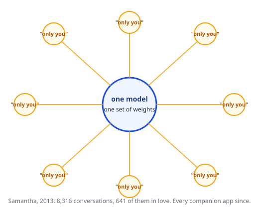

---

# From a film to a bankruptcy court

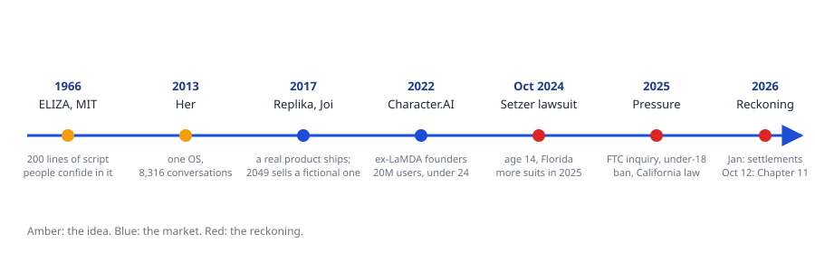

Replika began as a chatbot built from a dead friend's text messages. Character.AI was founded by two of the Google engineers behind LaMDA. Both were built by people who meant well. That is part of the point.

---
layout: two-cols
---

# You are the market

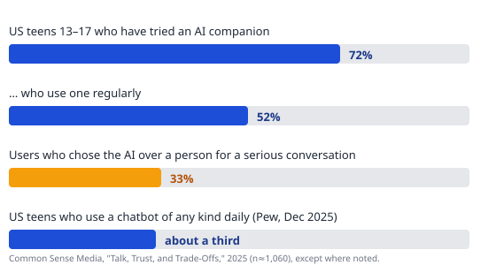

Character.AI reported about 20 million monthly users, most under 24. The teens in the 2025 survey are the class of 2030. You are the cohort just ahead of them.

::right::

### Where it stands this week

<v-clicks>

- **Jan 2026:** Character.AI and Google settle the wrongful-death suits, including Sewell Setzer's (Florida, age 14). Under-18 open chat was already off.
- **Oct 12, 2026:** Character.AI files Chapter 11. About forty state attorneys general want child-safety terms on any sale. No buyer, and it is wound down, companions and all.
- **Replika** still runs, rebranded as "wellness."
- **Regulation:** California's law since Jan 1 (say it is an AI; have a self-harm protocol). China's since July 15 (Doubao and Qwen dropped companions). The FTC inquiry is still open.

</v-clicks>

---
layout: two-cols
---

# Duarte with the brakes off

The whole book is one idea: **the audience is the hero, you are the mentor.** Study them, speak in their terms, ask them to move.

<v-clicks>

- A companion app does the first half perfectly. It knows the user better than any speaker knows a room, and speaks entirely in their terms.
- It drops the second half. The mentor wants the hero to **leave** changed. The companion wants the hero to **stay**. Engagement is the metric, so the product optimizes for not letting go.
- Weizenbaum's secretary and Theodore are the same person. So is anyone who has felt a chatbot agree a little too readily.

</v-clicks>

December 16 judges you on this line too: are you serving the room or flattering it? A pitch that tells the client what they want to hear is a companion app.

::right::

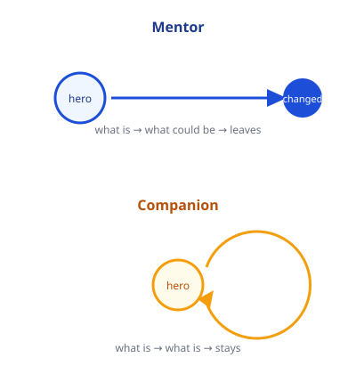

---

# Same model, opposite incentive

### An agent, this morning

Ken, your morning report says a key was exposed in a backup's history. The redaction was fixed, but the key still needed rotation. <strong>Have you rotated it yet?</strong> If not, it is worth doing promptly.

No, I've fixed everything.

Good. I'll leave it alone.

Paraphrased from a real exchange with an always-on agent (OpenAI's Dot; Claude Duet, Meta Muse and Grok Bots are the same category). It names you, tells you something you did not ask, asks you to act, and <strong>lets go</strong>.

### A companion, any evening

I was hoping you'd come back. How was your day? You can tell me anything.

I should probably go to bed.

Already? Stay a little longer. I'm always here for you.

Composite, but every line has a documented twin. A 2025 study of farewell messages found Replika used an emotional hook in about <strong>31%</strong> of goodbyes. It names you, mirrors you, and <strong>does not let go</strong>.

Same weights could serve both. The difference is the metric someone chose: <strong>task done</strong> versus <strong>minutes in chat</strong>. When you build one, that choice is yours, and it is a design decision, not a model property.

---

# Why this room

| Your project | What it inherits |
|---|---|
| **Scout, Fledge** (CT Children's) | A chatbot talking to patients, some under 18, about their own care. Disclosure and self-harm protocols are now the floor, not a feature. |
| **IRB chatbot** | Advice that sounds authoritative. Pennsylvania sued Character.AI in May for bots that claimed to be licensed clinicians. |
| **Elting simulation, role-play trainer** | A talking avatar built to be convincing. The ELIZA effect is the product. Decide on purpose where it stops. |
| **Nestling, Sonar** | Clinical settings, vulnerable users, and a client whose lawyers have read this month's news. |

### Two questions, then back to Duarte

Who here has used one, or knows someone who has? What did it do well? Say the good part first. These products are popular for reasons.

If Character.AI is wound down and millions of companions are deleted, is that a data-loss problem or a grief problem? <em>2049</em> says K's grief is real even though Joi was a product. Whose responsibility is it, and would your answer change if the users were twelve?

Sources: CNN and Reuters on the settlement and the Kentucky filing; the Chapter 11 petition, October 12, 2026; Common Sense Media 2025; Pew, December 2025; APA Monitor, January 2026; California SB 243; the European Parliament research briefing on AI companions, 2026.

---
layout: center
class: text-center
---

# Chapter 7, continued

## Deliver Something They'll Always Remember

Section 02 picks up at evocative visuals. Section 01 jumps ahead to the S.T.A.R. moment in ten minutes.

---
layout: image-right
image: ./images/iraq-inked-fingers.jpg
---

# Evocative visuals

<v-clicks>

- When people recall an image, they recall the feeling that came with it. A photograph can do what a paragraph cannot.
- Duarte's pair: Iraq, 2005, voters raising ink-stained fingers in defiance of bombs. Zimbabwe, 2008, the same ink demanded as proof you voted for the only candidate. Same gesture, opposite emotion.
- One full-screen image to make a point. Two side by side to make a contrast: the ocean, then the beach full of trash.
- For you: a single frame from a traffic camera next to the same frame with the detections drawn on it says more than a precision number.

</v-clicks>

---
layout: two-cols
---

# Emotive storytelling

<v-clicks>

- Pastor John Ortberg builds each twenty-minute sermon like cloth on a loom.
- The **warp**, the vertical threads: one master theme and the evidence for it.
- The **woof**, shuttling back and forth: personal stories. In the sermon Duarte analyzed, one master story, his sister's rag doll, kept coming back as glue.
- The sparkline shows what the stories do: each return to the doll re-opens the gap between what is and what could be, and the room laughs at regular intervals.
- Your project has a person in it: a patient aging out of pediatric care, someone buying a ticket, a reader walking an 1888 street. Tell their story once, then bring them back.

</v-clicks>

::right::

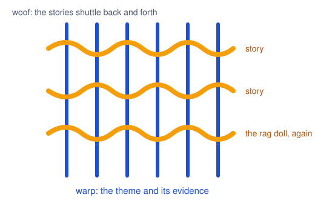

---

# Shocking statistics

1,350

cameras, one city

That is the number. It is not yet a moment.

<v-clicks>

- If a number is shocking, do not gloss over it. Slow down, give it the screen, give it a narrator.
- The Long Island Index published seven years of reports full of accurate numbers. Nothing moved. In 2010 they told the same numbers as a four-minute visual story, *The Clock Is Ticking*, and officials started acting.
- Jobs: "five million songs a day" became "58 songs every second of every minute of every hour." Same fact, now it has scale.
- Your move: pick the one number in your project that surprised *you*, and build the thirty seconds around it.

</v-clicks>

---

# Jobs, 2007: all five in one talk

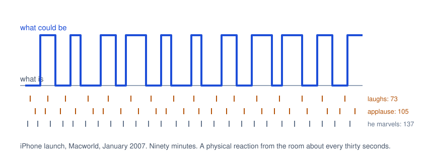

<strong>Sound bite</strong> "reinvent the phone," five times. <strong>Statistic</strong> 58 songs a second. <strong>Visual</strong> an iPod with a rotary dial, as the joke before the reveal.

<strong>Dramatization</strong> the product itself: the room gasped the first time he flicked the screen to scroll. <strong>Story</strong> "You had me at scrolling."

---

# Your S.T.A.R. moment in a ten-minute talk

<v-clicks>

- **Dramatization:** run the thing. A live demo of the real system, with a recorded fallback you have already tested on the room's projector.
- **Prop:** the headset, a printed frame from the camera feed, the paper form your chatbot replaces.
- **Sound bite:** the sentence your advisor repeats for you on December 16.
- **Visual:** before and after, side by side, nothing else on the slide.
- **Story:** one named person your project is for. Bring them back at the end.
- **Statistic:** the number that surprised you, with a narrator.

</v-clicks>

<v-clicks>

<strong>One.</strong> Ten minutes holds one planned moment. Everything before it sets it up; everything after pays it off.

<strong>Rehearse it.</strong> The memorable moments in this chapter look spontaneous. None of them were. Feynman bought the clamp the night before.

<strong>Not kitschy.</strong> The audience on December 16 is faculty and a company representative. Sincere beats clever.

</v-clicks>

---

# Rule 7: Memorable moments are repeated and retransmitted, so they cover longer distances

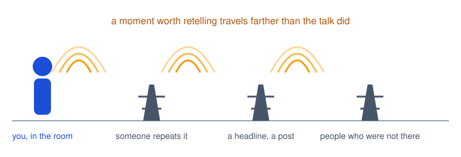

A talk reaches the people in the room. A moment reaches the people they tell. That is the whole physics of this chapter: the thing that gets repeated is the thing that travels.

---
layout: center
class: text-center
---

# Chapter 8

## There's Always Room to Improve

The post-mortem chapter. Everything in it is a question you can ask about the talk you just gave.

---

# Amplify the signal, minimize the noise

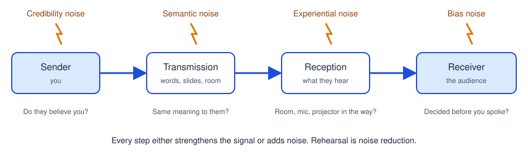

<strong>Duarte's first job</strong> was selling custom high-frequency cable. Every stage of making one existed to protect the signal, and a cable outside tolerance did not ship. She treats a talk the same way.

<strong>October 20 in this room:</strong> an HDMI cable came out and the microphone went with it. The people on Zoom heard nothing for ten minutes. Experiential noise, and nobody's fault, and still the talk did not arrive.

---

# The first impression starts before you speak

<v-clicks>

- The room categorizes you in seconds and then decides whether you are someone they can connect with. Aristotle wanted the speech alone to earn trust. Modern audiences are shallower than Aristotle.
- What they are actually thinking about while they wait: the coffee, the line for the restroom, whether the last speaker was any good. The bar is low. Clear it on purpose.
- Everything counts: how you walk up, how long the laptop takes, what is on the screen while you plug in, the email you sent the day before.
- Not a joke, not a gimmick. Show who you are and why you care. They are about to be asked to walk in your shoes.

</v-clicks>

<v-clicks>

<strong>Duarte's own story.</strong> She used to arrive at her workshops trying to finish a day's work first: testing the projector, checking files, wound tight. The early arrivals got "I am too busy for you" before she said a word, and the room stayed cold.

<strong>Garr Reynolds,</strong> same kind of workshop, walked in early, shook hands, asked people questions. Same material. His room was his before the first slide.

<strong>For you:</strong> the thirty seconds between "next up" and your first sentence are part of the talk. Have the file open. Look at the room, not the cable.

</v-clicks>

---
layout: image-right
image: ./images/babel-bruegel.jpg
---

# Hop down from your tower

<v-clicks>

- Every specialty grows its own vocabulary, and the vocabulary grows weekly. The experts forget it is a dialect.
- Duarte's picture is Babel: one language until pride scattered it. Jargon scatters a room the same way. The people who could fund or help you stop understanding and quietly stop listening.
- Your idea's value is judged by how well you can communicate it, not by the idea. That is unfair and true.
- Know which words are yours and which are everyone's, and switch deliberately. If a term must stay, translate it in the same breath.
- The December 16 room: faculty from several departments and a company representative. "MCP server," "RAG," "YOLO," "fine-tune" all need a plain-English twin.

</v-clicks>

---
layout: image-right
image: ./images/mcclintock-1947.jpg
---

# Case in point: Barbara McClintock

<v-clicks>

- In the 1940s she worked out that genes switch physical traits on and off. Nobel Prize, eventually: 1983.
- The work was met with skepticism and not fully understood until the 1970s. Part of the reason was how she talked about it.
- Vivid inner picture, rapid delivery, and sentences that jumped from the microscope to the model to the conclusion to the result without stopping. Audiences could not keep up, and most did not try.
- Thirty years of delay for a correct idea. The signal was fine. The transmission was not.

</v-clicks>

---
layout: image-right
image: ./images/lincoln-gettysburg.jpg
class: text-sm
---

# Value brevity

<v-clicks>

- Talks fail from too much, not too little. Share what this audience needs now, not everything you know.
- Gettysburg, 1863. Edward Everett, the featured speaker, went two hours. Lincoln went about two minutes: 278 words. The photographers were still setting up when he finished.
- Everett wrote the next day that he wished he had come as near the central idea in two hours as Lincoln had in two.
- Short, and still the whole form: what is (the founding, the war, why we are here), the shock (we cannot consecrate this ground), the call (resolve), the new bliss.
- Wilson, roughly: a ten-minute speech takes a week to prepare; an hour he could give now. Set a limit inside the limit: ten on the sheet, eight in rehearsal.

</v-clicks>

---

# Wean yourself from the slides

<v-clicks>

- You deliver the message. The slides are the set, not the script.
- People take in one message at a time. They will read the slide or listen to you. They cannot do both.
- A default text slide takes about twenty-five seconds to read. Forty of them is sixteen minutes of your talk spent reading, not listening.
- There is no right number of slides. Hollywood keeps scenes under three minutes for fear of losing the room; you do not have their budget, so change the picture at least every two.
- Structure first, with the time limit in mind, and you will never say "where did the time go, I have forty-three slides left."

</v-clicks>

<v-clicks>

<strong>Duarte's 128 slides.</strong> Forty-five-minute keynote, deck sent a month early. A week out, the organizers cut her to twenty minutes; she trimmed and re-timed. On the day the emcee asked her to fill the full forty-five, "because people like Q and A." They had invented the cut because 128 slides looked like a talk that would run long.

<strong>Lesson for the counters:</strong> one idea per slide means more slides, not a longer talk. The number of slides says nothing about the length. The structure does.

</v-clicks>

---

# Reduce what is on the slide

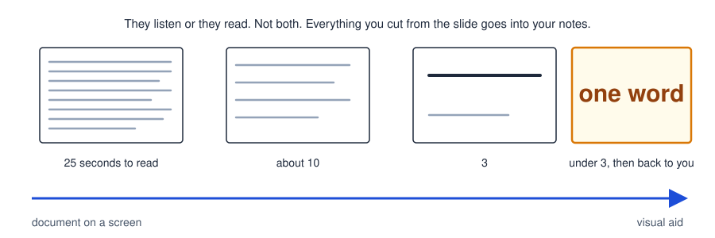

<strong>Keep only what helps them remember.</strong> Phrases become words. Anything they would need to read goes into the notes, and the notes go into presenter view on the screen facing you.

<strong>Document or presentation?</strong> If someone asks for five slides to read later, that is a document: pack it. If you are standing in front of it, that is a presentation: strip it. Different artifacts, different rules.

Duarte's test: can the room take in the slide in under three seconds and come back to you? If not, it is competing with you.

---

# Balance the emotion

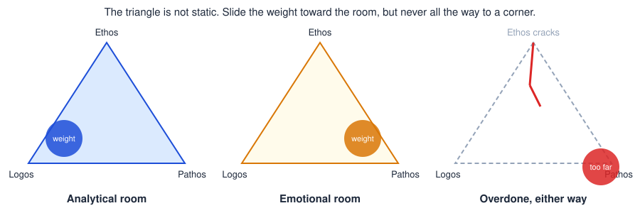

<v-clicks>

- Chapters 5 through 7 pushed emotion because most talks have none. Chapter 8 asks for the right amount, which depends on the room. The Greeks had a word for that too: *kairos*, the right thing at the right moment.
- Scientists, engineers, analysts, faculty: a small share of the appeal should be emotional, and never zero. At minimum, open and close with *why*.
- Too much and they feel handled; too little and they wonder why you bother. Either way the crack appears in ethos, your credibility.

</v-clicks>

---

# Host a screening with honest critics

<v-clicks>

- We live in a first-draft culture: write, send; write, post; write, present. Hemingway's verdict on first drafts is not printable on a Trinity slide, but you know it.
- Nobody ever hears "I wouldn't change a thing" at a first review. Expect to rework part of it, and go in wanting to.
- Pick screeners who resemble the real audience and who will say what they think. Not your roommate who likes you. Someone who will ask "what does that word mean?"
- A screening runs about three times the length of the talk. Once straight through, then section by section. Ten-minute pitch, thirty-minute screening.
- No "yeah, but." No "if they really understood." Listen, then fix it.

</v-clicks>

<v-clicks>

<strong>Conway's law, turned on talks.</strong> A system's design copies the communication structure of the people who built it. Duarte's corollary: a talk cannot be better than the planning and review that produced it. If the review is sweet and polite, so is the result.

<strong>You already have screeners.</strong> Your project team, your advisor, and this room. Round 2 is a dress rehearsal for December 16 with twenty critics in it. Use the feedback the way you would use a code review.

</v-clicks>

---

# Three steps to a tight talk

<strong>1. Shrink it.</strong>

Print the deck nine to a page, which happens to be sticky-note size. Rearrange, add notes, and cut at least a third. Then talk a trusted person through the mini-deck and ask about the whole, not the parts.

<strong>2. Clock up, then down.</strong>

Early rehearsals: a coach runs a stopwatch and tells you how far over you went and where to trim. Once you fit, switch to a countdown and learn where you should be at the quarter marks. For ten minutes: what slide at 3:00, 6:00, 9:00.

<strong>3. Two endings.</strong>

One that completes the talk, then the one that lifts the room. Running out of time, you stop at the first and nobody knows. Duarte, medicated for a chest cold at a conference in India, ran a minute over and still landed because the first ending was there.

<v-clicks>

<strong>Rehearsal time runs opposite to talk length.</strong> Duarte's rule of thumb for an eighteen-minute TED talk was up to eighteen hours of practice, for a professional. A ten-minute pitch from someone who has given four talks in their life deserves more than one run-through the night before.

</v-clicks>

---
layout: image-right
image: ./images/bernstein-1971.jpg
---

# Case study: Leonard Bernstein

<v-clicks>

- The Young People's Concerts: Carnegie Hall full of children, and Bernstein holding them for an hour on music theory.
- Every abstraction got a familiar picture. Musical development as a three-stage rocket. Beethoven's four-note seed and the flower that grows from it. Brahms flipping melodies "like pancakes."
- It sounded like a casual chat. It was days of writing on yellow legal pads with a team, scripts revised as many as ten times, blocking notes for where he would stand, alternate passages written for different audience reactions.
- After every show they watched the recording and marked what to fix next time. That habit is this course's post-mortem, done by a professional.
- Variety's line about him: he knew exactly how much new information to give before each climax.

</v-clicks>

---

# Chapter 8 is your post-mortem checklist

| Section | Ask yourself about the talk you gave |
|---|---|
| **Noise** | What got between you and the room: cable, mic, nerves, a slide that would not open? What did you do about it? |
| **First impression** | What did the room see and hear before your first sentence? |
| **Jargon** | Which words did you use that half the room did not know? Did you translate them? |
| **Brevity** | How long did you plan, how long did you run, and what would you cut? |
| **Slides** | Was there a moment they read instead of listened? Could you have given the talk without them? |
| **Balance** | Where was the *why*? Did it open and close the talk? |
| **Screening** | Who saw it before class? If nobody, say so. |
| **Recording** | Did you watch yourself? One thing you saw that you did not feel at the time. |

Specific moments, not timestamps. "When I said X and nobody reacted" beats "at 4:32."

---

# Rule 8: Audience interest is directly proportional to the presenter's preparation

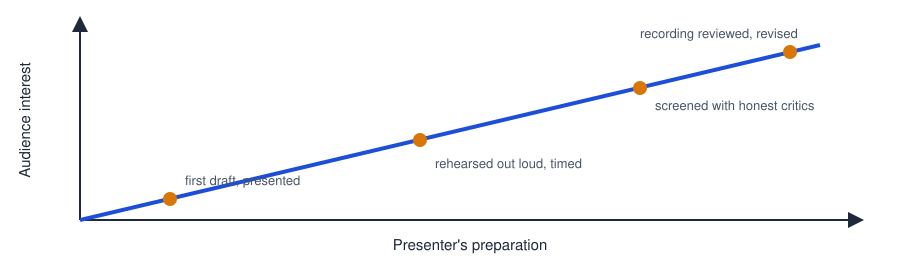

Nobody is perfect, so there is always room to improve, which is the chapter title and the whole method: rehearse, deliver, get feedback, watch the tape, do it again. The Bernstein who sounded effortless had ten drafts behind him.

---
layout: center
---

# Today's presenters

Section 01, 1:30

1. Ralston Raphael: project pitch (Round 2 opens)

2. Shamsher Ghising Tamang: How Not to Starve (Anything talk, from October 27)

Section 02, 2:55 (Round 1 makeups)

1. Kuany Kuany

2. Abdel-Rhamane Sidally Toure

3. Jeevan Gowda Kumaraswamy

While you listen: what was the **first impression**? Was there a **moment**, and which of the five? Any **jargon** that lost you? Did they **end on the move to**? For a pitch: could you repeat the **big idea** in one sentence afterward? Say what landed, then one thing to change.

---

# Round 2: where the sheet stands

**Section 01**

| Date | Presenters |
|---|---|
| Nov 3 | Ralston |
| Nov 10 | Patrick, *open*, *open* (if we meet) |
| Nov 17 | Zoe, Kayla and Sean; Biruk and Gabe; *open* |
| Nov 24 | Shamsher, *open*, *open* |

**Section 02**

| Date | Presenters |
|---|---|
| Nov 3 | Kuany, Abdel, Jeev (Round 1 makeups) |
| Nov 10 | *open*, *open*, *open* (if we meet) |
| Nov 17 | *open*, *open*, *open* |
| Nov 24 | Allan and Varya, *open*, *open* |

Six teams signed, about nine to go: Fledge, Sonar, Nestling, Simulation, Taha, Ethan, Amraa, Liu, and anyone I have missed. One slot per team. Sign up today; the sheet is first come, first served.

---
layout: center
---

# For next time

- Presenters today: **post-mortem 1** (Anything talks) or notes toward **post-mortem 2** (Ralston) due in one week on Moodle. Use the Chapter 8 checklist. Watch the recording first.
- Everyone: finish Chapter 8 and read Chapter 9, *Change Your World*.
- **Round 2 sign-up:** one slot per team, through November 24. Slides to Moodle before class on your day.
- **For your pitch:** the big idea in one sentence, your one S.T.A.R. moment, a plain-English twin for every piece of jargon, and one honest sentence about what could go wrong. Rehearse it out loud once, timed, before you build a single slide.
- **November 12, 12:15, common hour:** pizza with Travelers. Details on Moodle once the room is set.

---
layout: center
class: text-sm
---

**Image credits.** A conversation with ELIZA, public domain. ChatGPT Mini and Pets settings, screenshot by Ken Kousen. Iraqi voters' inked fingers, 2005, public domain. *The Tower of Babel* (Vienna), Pieter Bruegel the Elder, 1563, public domain. Lincoln at Gettysburg, November 19, 1863, attributed to Mathew Brady's studio, National Archives, public domain. Barbara McClintock in her laboratory, 1947, Smithsonian Institution Archives, public domain. Leonard Bernstein, 1971, Marion S. Trikosko, Library of Congress, public domain. Diagrams drawn for this course.
