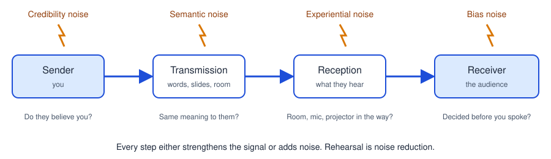
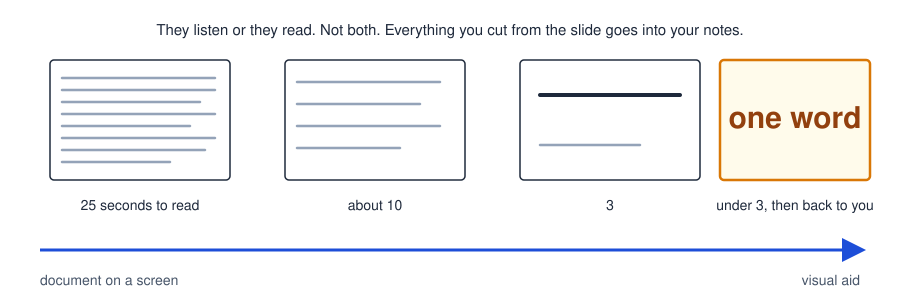
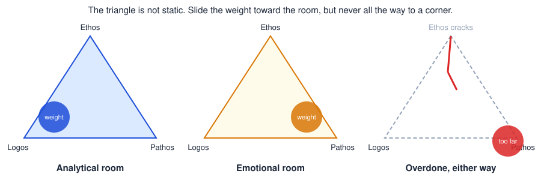
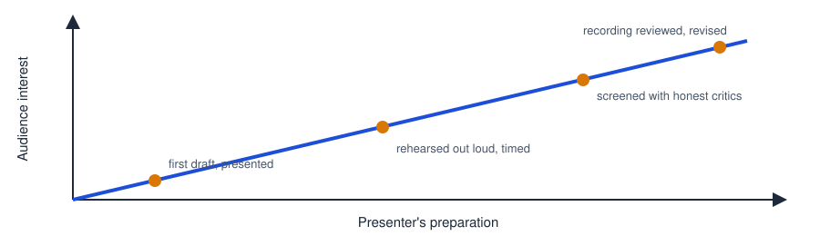
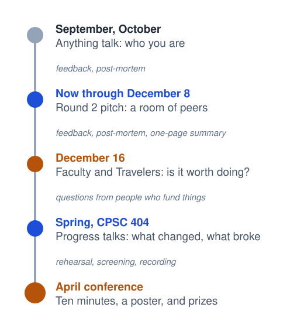
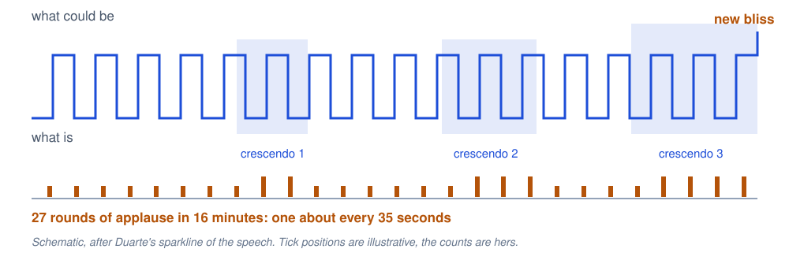
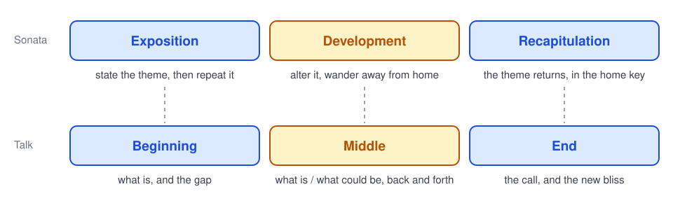
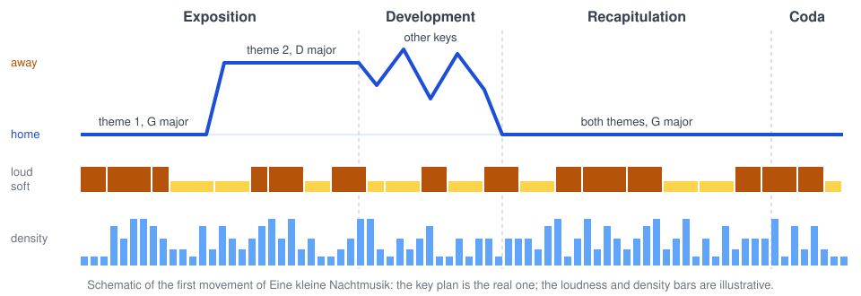

# CPSC 403: Computer Science Seminar

## Week 10, November 24, 2026

Chapter 8: There's Always Room to Improve. Chapter 9: Change Your World. Coda: Inspiration Is Everywhere.

Trinity College · Fall 2026

---
layout: two-cols
---

# Check in

Scan the code, pick your name, pick today's section, and type the code word. Lowercase, but I am not picky about case.

Code word: <strong>sonny</strong>

Same form every week, different word. Timestamps count as attendance.

::right::

---
layout: center
---

# Today

<v-clicks>

- Housekeeping, and the Round 2 sheet: **no talks today**, six pitches next week, and three teams still not signed up
- The **Travelers one-page summary**: a worked example
- Why the code word is **sonny**
- Chapter 8, *There's Always Room to Improve*: the post-mortem chapter
- Chapter 9, *Change Your World*: Enron, Dr. King, Martha Graham, and why one talk is never enough
- The Coda, *Inspiration Is Everywhere*: Mozart, and the last rule. **That finishes the book.**

</v-clicks>

---

# Housekeeping

<v-clicks>

- **Round 2:** two talk days left, **December 1** and **December 8**. Slides to Moodle before class on your day. Next slide.
- **Post-mortem 2:** one week after your pitch; nothing accepted after **December 15**.
- **Post-mortem 1:** four are still out. Specific moments, not timestamps.
- **One-page project summary** per team, on the Travelers template, due **Wednesday, December 9.** Every team member uploads the same file.
- **Spring registration:** email me for a **CPSC 404 PIN** and say which section; file the **Special Registration form for CPSC 499** with your advisor's approval.
- **AI Center:** no meeting this Friday. Next one is Friday, December 4, 3 PM.
- **December 16,** MECC 270, 8:30 AM: the student conference.

</v-clicks>

---

# Round 2: where the sheet stands

**Section 01**

| Date | Presenters |
|---|---|
| Nov 24 | *nobody* |
| Dec 1 | Ethan; Biruktayit, Gabe and Ralston; Shamsher and Taha |
| Dec 8 | Patrick; Zoe, Kayla and Sean; Sarah and Shane |

**Section 02**

| Date | Presenters |
|---|---|
| Nov 24 | *nobody* |
| Dec 1 | Noella and Gabi; Allan and Varya; Amraa |
| Dec 8 | Sloane; *open*, *open* |

<strong>Not on the sheet:</strong> Nestling (AJ, Kuany, Abdel), Leo, Jeev. Three pitches and two open slots, both in Section 02 on December 8. We settle it before you leave today.

<strong>Presenting December 1:</strong> you have feedback time before the conference. <strong>Presenting December 8:</strong> you have eight days, in the last week of classes. Screen it with someone first.

---

# The one-page summary: a worked example

"Rehearsal Coach," a made-up project no team is doing. The full example is on Moodle beside the blank template, in the December 8 week.

| Section | What the example says |
|---|---|
| **Who it's for** | Seniors preparing a ten-minute project pitch |
| **Why it matters** | Most rehearse once, silently, and find out in front of the room that they run long |
| **What we're making** | A web tool that listens to a practice run and reports time per slide, pace and jargon |
| **Measure and target** | Stopwatch at the April conference: 8 of 10 users finish within 30 seconds of ten minutes |
| **Early test** | Before building anything, mark up five recorded rehearsals by hand and see if the report changes the second run |
| **A milestone** | Feb 15, timing works on a recording. Keep going if within 5 seconds of a stopwatch; rethink if transcription fails on room audio |
| **A risk** | Classroom audio too poor to transcribe: test with a phone in week one, fall back to a clip-on mic |

<strong>One sentence each, plain words.</strong> No "leveraging" and no architecture. A reader outside computer science can follow every line.

<strong>Every target is a number, and every milestone has an exit.</strong> "We adjust or rethink if we see…" is the column students leave blank. Travelers put it there on purpose.

<strong>The early test needs no code.</strong> If a hand-made report does not change behavior, software will not either. Find the cheapest way to be wrong.

---
layout: image-right
image: ./images/asimov-1981.jpg
class: text-sm
---

# Why sonny?

***I, Robot*, 2004,** suggested by Isaac Asimov's stories and his Three Laws of Robotics (1942).

<v-clicks>

- Every robot in the film obeys the Three Laws. **Sonny** was built with the ability to set them aside, and he is the one who dreams, draws, and asks what he is for.
- The detective, sure that a machine can only imitate: "Can a robot write a symphony? Can a robot turn a canvas into a beautiful masterpiece?" Sonny: **"Can you?"**
- The villain is the system that follows its rules perfectly, to a conclusion nobody intended.

</v-clicks>

Today ends with a symphony composer and the advice to be flexible within the form. Know the rules well enough to decide when they apply.

<!--
Photo is Asimov, not the film. The Three Laws first appear in full in the story "Runaround," 1942. The film's rule-following system is VIKI. Spoils the film mildly.
-->

---
layout: center
class: text-center
---

# Chapter 8

## There's Always Room to Improve

The post-mortem chapter. Everything in it is a question you can ask about the talk you just gave.

---

# Amplify the signal, minimize the noise

<strong>Duarte's first job</strong> was selling custom high-frequency cable. Every stage of making one existed to protect the signal, and a cable outside tolerance did not ship. She treats a talk the same way.

<strong>October 20 in this room:</strong> an HDMI cable came out and the microphone went with it. The people on Zoom heard nothing for ten minutes. Experiential noise, and nobody's fault, and still the talk did not arrive.

---

# The first impression starts before you speak

<v-clicks>

- The room categorizes you in seconds and then decides whether you are someone they can connect with. Aristotle wanted the speech alone to earn trust. Modern audiences are shallower than Aristotle.
- What they are actually thinking about while they wait: the coffee, the line for the restroom, whether the last speaker was any good. The bar is low. Clear it on purpose.
- Everything counts: how you walk up, how long the laptop takes, what is on the screen while you plug in, the email you sent the day before.
- Not a joke, not a gimmick. Show who you are and why you care. They are about to be asked to walk in your shoes.

</v-clicks>

<v-clicks>

<strong>Duarte's own story.</strong> She used to arrive at her workshops trying to finish a day's work first: testing the projector, checking files, wound tight. The early arrivals got "I am too busy for you" before she said a word, and the room stayed cold.

<strong>Garr Reynolds,</strong> same kind of workshop, walked in early, shook hands, asked people questions. Same material. His room was his before the first slide.

<strong>For you:</strong> the thirty seconds between "next up" and your first sentence are part of the talk. Have the file open. Look at the room, not the cable.

</v-clicks>

---
layout: image-right
image: ./images/babel-bruegel.jpg
class: text-sm
---

# Hop down from your tower

<v-clicks>

- Every specialty grows its own vocabulary, and the vocabulary grows weekly. The experts forget it is a dialect.
- Duarte's picture is Babel: one language until pride scattered it. Jargon scatters a room the same way. The people who could fund or help you stop understanding and quietly stop listening.
- Your idea's value is judged by how well you can communicate it, not by the idea. That is unfair and true.
- Know which words are yours and which are everyone's, and switch deliberately. If a term must stay, translate it in the same breath.
- The December 16 room: faculty from several departments and a company representative. "MCP server," "RAG," "YOLO," "fine-tune" all need a plain-English twin.

</v-clicks>

---
layout: image-right
image: ./images/mcclintock-1947.jpg
class: text-sm
---

# Case in point: Barbara McClintock

<v-clicks>

- In the 1940s she worked out that genes switch physical traits on and off. Nobel Prize, eventually: 1983.
- The work was met with skepticism and not fully understood until the 1970s. Part of the reason was how she talked about it.
- Vivid inner picture, rapid delivery, and sentences that jumped from the microscope to the model to the conclusion to the result without stopping. Audiences could not keep up, and most did not try.
- Thirty years of delay for a correct idea. The signal was fine. The transmission was not.

</v-clicks>

---
layout: image-right
image: ./images/lincoln-gettysburg.jpg
class: text-sm
---

# Value brevity

<v-clicks>

- Talks fail from too much, not too little. Share what this audience needs now, not everything you know.
- Gettysburg, 1863. Edward Everett, the featured speaker, went two hours. Lincoln went about two minutes: 278 words. The photographers were still setting up when he finished.
- Everett wrote the next day that he wished he had come as near the central idea in two hours as Lincoln had in two.
- Short, and still the whole form: what is (the founding, the war, why we are here), the shock (we cannot consecrate this ground), the call (resolve), the new bliss.
- Wilson, roughly: a ten-minute speech takes a week to prepare; an hour he could give now. Set a limit inside the limit: ten on the sheet, eight in rehearsal.

</v-clicks>

---

# Wean yourself from the slides

<v-clicks>

- You deliver the message. The slides are the set, not the script.
- People take in one message at a time. They will read the slide or listen to you. They cannot do both.
- A default text slide takes about twenty-five seconds to read. Forty of them is sixteen minutes of your talk spent reading, not listening.
- There is no right number of slides. Hollywood keeps scenes under three minutes for fear of losing the room; you do not have their budget, so change the picture at least every two.
- Structure first, with the time limit in mind, and you will never say "where did the time go, I have forty-three slides left."

</v-clicks>

<v-clicks>

<strong>Duarte's 128 slides.</strong> Forty-five-minute keynote, deck sent a month early. A week out, the organizers cut her to twenty minutes; she trimmed and re-timed. On the day the emcee asked her to fill the full forty-five, "because people like Q and A." They had invented the cut because 128 slides looked like a talk that would run long.

<strong>Lesson for the counters:</strong> one idea per slide means more slides, not a longer talk. The number of slides says nothing about the length. The structure does.

</v-clicks>

---

# Reduce what is on the slide

<strong>Keep only what helps them remember.</strong> Phrases become words. Anything they would need to read goes into the notes, and the notes go into presenter view on the screen facing you.

<strong>Document or presentation?</strong> If someone asks for five slides to read later, that is a document: pack it. If you are standing in front of it, that is a presentation: strip it. Different artifacts, different rules.

Duarte's test: can the room take in the slide in under three seconds and come back to you? If not, it is competing with you.

---

# Balance the emotion

<v-clicks>

- Chapters 5 through 7 pushed emotion because most talks have none. Chapter 8 asks for the right amount, which depends on the room. The Greeks had a word for that too: *kairos*, the right thing at the right moment.
- Scientists, engineers, analysts, faculty: a small share of the appeal should be emotional, and never zero. At minimum, open and close with *why*.
- Too much and they feel handled; too little and they wonder why you bother. Either way the crack appears in ethos, your credibility.

</v-clicks>

---

# Host a screening with honest critics

<v-clicks>

- We live in a first-draft culture: write, send; write, post; write, present. Hemingway's verdict on first drafts is not printable on a Trinity slide, but you know it.
- Nobody ever hears "I wouldn't change a thing" at a first review. Expect to rework part of it, and go in wanting to.
- Pick screeners who resemble the real audience and who will say what they think. Not your roommate who likes you. Someone who will ask "what does that word mean?"
- A screening runs about three times the length of the talk. Once straight through, then section by section. Ten-minute pitch, thirty-minute screening.
- No "yeah, but." No "if they really understood." Listen, then fix it.

</v-clicks>

<v-clicks>

<strong>Conway's law, turned on talks.</strong> A system's design copies the communication structure of the people who built it. Duarte's corollary: a talk cannot be better than the planning and review that produced it. If the review is sweet and polite, so is the result.

<strong>You already have screeners.</strong> Your project team, your advisor, and this room. Round 2 is a dress rehearsal for December 16 with twenty critics in it. Use the feedback the way you would use a code review.

</v-clicks>

---

# Three steps to a tight talk

<strong>1. Shrink it.</strong>

Print the deck nine to a page, which happens to be sticky-note size. Rearrange, add notes, and cut at least a third. Then talk a trusted person through the mini-deck and ask about the whole, not the parts.

<strong>2. Clock up, then down.</strong>

Early rehearsals: a coach runs a stopwatch and tells you how far over you went and where to trim. Once you fit, switch to a countdown and learn where you should be at the quarter marks. For ten minutes: what slide at 3:00, 6:00, 9:00.

<strong>3. Two endings.</strong>

One that completes the talk, then the one that lifts the room. Running out of time, you stop at the first and nobody knows. Duarte, medicated for a chest cold at a conference in India, ran a minute over and still landed because the first ending was there.

<v-clicks>

<strong>Rehearsal time runs opposite to talk length.</strong> Duarte's rule of thumb for an eighteen-minute TED talk was up to eighteen hours of practice, for a professional. A ten-minute pitch from someone who has given four talks in their life deserves more than one run-through the night before.

</v-clicks>

---
layout: image-right
image: ./images/bernstein-1971.jpg
class: text-sm
---

# Case study: Leonard Bernstein

<v-clicks>

- The Young People's Concerts: Carnegie Hall full of children, and Bernstein holding them for an hour on music theory.
- Every abstraction got a familiar picture. Musical development as a three-stage rocket. Beethoven's four-note seed and the flower that grows from it. Brahms flipping melodies "like pancakes."
- It sounded like a casual chat. It was days of writing on yellow legal pads with a team, scripts revised as many as ten times, blocking notes for where he would stand, alternate passages written for different audience reactions.
- After every show they watched the recording and marked what to fix next time. That habit is this course's post-mortem, done by a professional.

</v-clicks>

---

# Chapter 8 is your post-mortem checklist

| Section | Ask yourself about the talk you gave |
|---|---|
| **Noise** | What got between you and the room: cable, mic, nerves, a slide that would not open? What did you do about it? |
| **First impression** | What did the room see and hear before your first sentence? |
| **Jargon** | Which words did you use that half the room did not know? Did you translate them? |
| **Brevity** | How long did you plan, how long did you run, and what would you cut? |
| **Slides** | Was there a moment they read instead of listened? Could you have given the talk without them? |
| **Balance** | Where was the *why*? Did it open and close the talk? |
| **Screening** | Who saw it before class? If nobody, say so. |
| **Recording** | Did you watch yourself? One thing you saw that you did not feel at the time. |

Specific moments, not timestamps. "When I said X and nobody reacted" beats "at 4:32."

---

# Rule 8: Audience interest is directly proportional to the presenter's preparation

Nobody is perfect, so there is always room to improve, which is the chapter title and the whole method: rehearse, deliver, get feedback, watch the tape, do it again. The Bernstein who sounded effortless had ten drafts behind him.

---
layout: center
class: text-center
---

# Chapter 9

## Change Your World

The last full chapter. Less technique, more reasons: why any of this is worth the hours.

---
layout: image-right
image: ./images/jfk-congress-1961.jpg
---

# Changing the world is hard

<v-clicks>

- "I have an idea" means "I want to change something." Everything in this room began as someone's dissatisfaction with how things were.
- It takes putting your name on it. Some people will reject it. The reward goes to the ones who keep going.
- An idea is not alive while it sits in one head. It lives when a second person adopts it, then a third.
- **Kennedy to Congress, May 1961:** not one man going to the moon, an entire nation. The story Duarte tells: touring NASA, he asks a man with a mop what he does. "I'm putting the first man on the moon, sir."

</v-clicks>

December 16 is this, small. You are not reporting on a project. You are asking a room to want it to exist.

---
layout: two-cols
---

# One talk is never enough

<v-clicks>

- Al Gore gave his climate slideshow hundreds of times, and versions of the message since the 1970s, before anyone made a film of it. The film won an Academy Award. The talk came first, over and over.
- Everyone profiled in this book did the same. Not one great speech: one message, delivered for years to different rooms.
- An idea gets adopted through a series of presentations, and each one is a chance to tune the approach, gather resources and realign the team.
- The thinking you do to prepare is worth as much as the talk. Half of what a pitch does is make *you* decide what the project is.
- Duarte quotes Marty Neumeier: if a business is a decision factory, the presentations feeding it set the quality of the decisions.

</v-clicks>

Yours is already a series. Same project, five rooms, five chances to get better at saying it.

::right::

---
layout: image-right
image: ./images/enron-code-of-ethics.jpg
---

# Don't use presentations for evil

<v-clicks>

- Hundreds of slides were evidence at the **Enron** trial. Counts against Skilling, Lay and Causey were tied to specific presentations: earnings calls, employee meetings.
- **It began with a deck.** The CFO's slick presentation on the partnerships that hid the debt left managers confused. It sounded too good to be true.
- **A deck could have stopped it.** In 1999 the auditor warned the board about risky accounting, feebly, on dense slides. His margin note: "Obviously, we are on board with all of these."
- The charts went up, employees were urged to buy, and the executives sold.

</v-clicks>

Two failures, not one: the confident deck that carried a lie, and the timid deck that buried the truth. The second one is the one engineers commit.

---

# The honest pitch

### Ways a senior project pitch shades the truth

<v-clicks>

- The demo that only works on the one input you rehearsed, presented as the system.
- "The model achieves 94 percent" with no mention of what it was tested on, or how small the test set was.
- A screenshot of something you designed, shown as something you built.
- "We plan to" quietly becoming "we have."
- Leaving out the client's real constraint because it makes the project look smaller.

</v-clicks>

### And the Duncan failure

<v-clicks>

- You found a real problem (the data is not coming, the approach does not scale, the client wants something else) and it is on slide 9 in gray, 14-point type.
- If it matters, it gets its own slide, in plain words, early enough to be discussed.

</v-clicks>

<strong>For December 16:</strong> one honest sentence about what could go wrong, said out loud, not hidden. Faculty trust the team that names its own risk. Ava passed her test by telling Caleb what he wanted to hear; that is not the test you are taking.

---
layout: image-right
image: ./images/mlk-march-1963.jpg
---

# Case study: Martin Luther King, Jr.

August 28, 1963, the steps of the Lincoln Memorial, the March on Washington.

<v-clicks>

- **Contour:** he moves between what is and what could be quickly, which suits a crowd already at high energy.
- **Repetition:** word sequences repeated for emphasis, and near the end "I have a dream" returning like the refrain of a hymn.
- **Visual words:** from "the dark and desolate valley of segregation" to "the sunlit path of racial justice." You can see both places.
- **Common ground:** hymns and Scripture the crowd knew by heart, and the country's own documents: the Declaration, the Constitution, Gettysburg. He asks the country to keep its word.

</v-clicks>

---

# Sixteen minutes

<strong>Pauses.</strong> Duarte prints the transcript with a line break at every pause. Read it that way and you breathe where he did. Silence is part of the delivery.

<strong>Pace.</strong> He speeds up and slows down, building three separate crescendos, the last one into the new bliss. Chapter 6's "contrast the delivery," by ear.

<strong>Cost.</strong> His house was bombed, he was stabbed, and he was killed for the idea. Duarte's line for the chapter: great communicators create movements.

---
layout: image-right
image: ./images/emperor-new-clothes.jpg
backgroundSize: contain
---

# Be transparent, so they see the idea

Stop promoting yourself and the room can look past you at the idea.

<v-clicks>

- **Be honest.** Nobody believes the flawless expert. Say where you failed and how you got past it.
- **Be unique.** People hide their differences to fit in. The difference is the reason to listen to you.
- **Don't compromise.** Say what you believe, plainly. The child in *The Emperor's New Clothes* ended the whole pretense with one sentence.

</v-clicks>

A post-mortem that says "nobody laughed, and here is why" is transparency on paper. Out loud is the next step.

---
layout: image-right
image: ./images/graham-ross-1961.jpg
---

# Case study: Martha Graham

<v-clicks>

- Told she was too old, too short, too heavy and too plain to dance. Good enough to teach, they said.
- Ballet was three hundred years of court spectacle: graceful, and no use for saying anything true. She built a new vocabulary, stark and angular, and was ridiculed for it.
- ***Lamentation*, 1930.** Seated, wrapped in a tube of stretch fabric, twisting as if to get out of her own skin. Not a dance about grief: grief itself.

</v-clicks>

A woman came backstage in Brooklyn. She had seen her nine-year-old son killed by a truck and had been unable to cry. That night she could. Graham's lesson: there is always one person in the audience you are speaking to. One.

---

# Graham: the work, and the fear

### It was never effortless

<v-clicks>

- A new dance began as what she called a time of great misery: propped up in bed with a typewriter, writing all night.
- Notebooks of impressions and quotations from psychology, yoga, poetry, Greek myth, the Bible, until a pattern showed and she could write a detailed script.
- Collect widely, find the structure, then script it. That is Chapters 5 and 6, from a choreographer.

</v-clicks>

### The dancer who was afraid to speak

<v-clicks>

- In 1955 the State Department sent her on tour as a cultural ambassador, with a lecture in every city. Speaking terrified her. Agnes de Mille describes her clinging to the barre, not knowing what to do with her hands, and locking herself in the dressing room.
- She kept doing it. Officials later called her the greatest single ambassador the country had sent to Asia, and she lectured, spellbindingly, until she was ninety.

</v-clicks>

One of the most commanding performers of the century had stage fright at a lectern, and fixed it the only way anyone does: repetition.

---
layout: center
---

# You can transform your world

<v-clicks>

- At some point, making one idea clear to one room will shape what happens to you next. For most of you the first such room is in MECC 270 on December 16.
- The care you put into communicating an idea should match the value you place on it. If it is worth a year of your work, it is worth more than one evening of slides.
- Great presenters are made. The people in this book, a marketer, a politician, a conductor, a lecturer, a preacher, an executive, an activist, an artist, put hundreds of hours into the words, the structure and the delivery. None of them were naturals.
- It is not fair that an idea is judged by how well it is presented. It happens every day, and it will happen to yours.

</v-clicks>

There is so much insincere noise that an idea presented with sincerity and preparation stands out. That is the book's title and its whole claim: it <em>resonates</em>. The last rule, Rule 9, is in the Coda, which is next.

---
layout: center
class: text-center
---

# Coda

## Inspiration Is Everywhere

The last few pages of the book: one composer, one more rule.

---
layout: image-right
image: ./images/mozart-krafft.jpg
---

# Mozart: be flexible within the form

<v-clicks>

- Classical composers wrote inside a fixed plan called **sonata form**. Everyone used it. Nobody mistakes one composer's sonata for another's.
- Duarte's point: a form is not a formula. The presentation form she has drawn since Chapter 2 is the same kind of thing.
- Structure is what lets a listener **anticipate**. You can only be surprised if you were expecting something.
- So the rules are there to be played against, by someone who knows them.

</v-clicks>

Every Round 1 talk in this room had a beginning, a middle and an end. No two sounded alike. That was the form doing its job.

---

# Sonata form is the presentation form

<strong>Exposition.</strong> The theme is stated and usually repeated. The listener has to know it cold, or they cannot hear it change later.

<strong>Development.</strong> The theme is altered and played with. The interest is the distance between what it was and what it has become.

<strong>Recapitulation.</strong> The original theme comes back. It is the same notes, and it does not feel the same, because of where you have been.

---

# Contrast, in three layers

| In the music | What it is | In your talk (Chapter 6) |
|---|---|---|
| **Tonal** | Leaving the home key and returning to it. The ear knows when it is away. | **Content:** what is, what could be |
| **Dynamic** | Loud and soft, changed suddenly or gradually | **Delivery:** pace, volume, a pause, a demo after slides |
| **Textural** | Everyone in unison, or one melody over accompaniment; few notes per measure, or many | **Emotion and density:** analysis, then a story; a full slide, then one word |

---
layout: image-right
image: ./images/beethoven-stieler.jpg
---

# See it, and you hear it

<v-clicks>

- Duarte's son charted the first movement of ***Eine kleine Nachtmusik*** as a sparkline, and then a Beethoven sonata the same way. Same form, very different shapes.
- She says working through it with him taught her how to listen to classical music. Once the structure was visible she could hear it.
- That is what the sparklines in this book were for: Jobs, Feynman, King. You saw the shape and then you could hear the talk.

</v-clicks>

<strong>For your pitch:</strong> draw its sparkline before you rehearse. Where does it leave home? Where does it come back? If the line is flat, so is the talk.

<!--
Both animations are on the Coda page of the free edition and on Vimeo: vimeo.com/70073374 (Mozart) and vimeo.com/70073375 (Beethoven). Worth playing the first minute of the Mozart.
-->

---

# Rule 9: Your imagination can create a reality

Duarte gives the last rule to the filmmaker **James Cameron**, and it is the only one of the nine that is not about the audience.

<v-clicks>

- One idea from one mind can change things. Chapter 9 was the evidence.
- Picture the world in which your project exists and works. That picture is what keeps you willing to explain it for the fifth time.
- Her closing instruction: be flexible, be visionary, and go rewrite the rules.

</v-clicks>

Can a robot write a symphony? Can a robot turn a canvas into a beautiful masterpiece?

Can you?

On December 16 the answer is supposed to be yes. You imagined something that does not exist yet, and you are asking a room to see it.

---

# The nine rules

| | Rule | Chapter | In one line |
|---|---|---|---|
| 1 | Resonance causes change | Why Resonate? | Match the room and it moves |
| 2 | Story has an exponential effect | Myths and Movies | Facts inform; stories carry |
| 3 | Tune to their frequency and they will move | Get to Know the Hero | The audience is the hero, you are the mentor |
| 4 | A body at rest stays at rest | Define the Journey | Name the move you are asking for, and what it costs |
| 5 | Filter for the resonant frequency | Create Meaningful Content | Collect widely, then cut |
| 6 | Structure is greater than the sum of its parts | Structure Reveals Insights | Order is an argument |
| 7 | Memorable moments are repeated and retransmitted | Something They'll Always Remember | One planned S.T.A.R. moment |
| 8 | Audience interest is proportional to preparation | Room to Improve | Rehearse, screen, watch the tape |
| 9 | Your imagination can create a reality | Coda | See it first, then make them see it |

That is the book. From here on the course is you, doing it: pitches December 1 and 8, the conference December 16.

---
layout: center
---

# For next time

- **December 1 presenters:** Ethan; Biruktayit, Gabe and Ralston; Shamsher and Taha; Noella and Gabi; Allan and Varya; Amraa. **Slides to Moodle before class.**
- **Not signed up yet?** Do it today.
- **Post-mortem 1** if you still owe it. **Post-mortem 2** a week after your pitch.
- **One-page project summary,** one per team, due **Wednesday, December 9.** Start from the example.
- **Spring registration:** CPSC 404 PIN by email, CPSC 499 by the Special Registration form.
- **For your pitch:** the big idea in one sentence, one S.T.A.R. moment, a plain-English twin for every piece of jargon, one honest sentence about what could go wrong, and a sparkline that leaves home and comes back.
- **Happy Thanksgiving.** No AI Center this Friday.

---
layout: center
class: text-sm
---

**Image credits.** Isaac Asimov, 1981, Rochester Institute of Technology *News and Events*, public domain. *The Tower of Babel* (Vienna), Pieter Bruegel the Elder, 1563, public domain. Lincoln at Gettysburg, November 19, 1863, attributed to Mathew Brady's studio, National Archives, public domain. Barbara McClintock in her laboratory, 1947, Smithsonian Institution Archives, public domain. Leonard Bernstein, 1971, Marion S. Trikosko, Library of Congress, public domain. President Kennedy addressing Congress, May 25, 1961, NASA, public domain. Enron Code of Ethics, FBI, public domain. Martin Luther King, Jr. at the March on Washington, August 28, 1963, Rowland Scherman, National Archives, public domain. *The Emperor's New Clothes*, Vilhelm Pedersen, 1849, public domain. Martha Graham and Bertram Ross, 1961, Carl Van Vechten, Library of Congress, public domain. Wolfgang Amadeus Mozart, posthumous portrait by Barbara Krafft, 1819, public domain. Ludwig van Beethoven, Joseph Karl Stieler, 1820, public domain. Diagrams drawn for this course.
